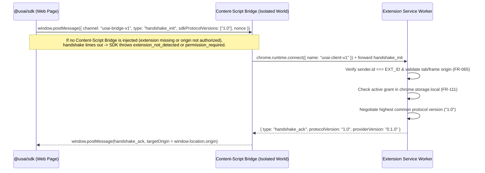

# UOAI — API and SDK Integration Requirements

| Field | Value |
|---|---|
| Document | API and SDK Integration Requirements |
| Version | 0.1 (Draft for review) |
| Parent | [BRD.md](../business/BRD.md) |
| Related | [ARCHITECTURE_CONSTRAINTS.md](ARCHITECTURE_CONSTRAINTS.md), [FUNCTIONAL_REQUIREMENTS.md](../requirements/FUNCTIONAL_REQUIREMENTS.md), [SECURITY_AND_PRIVACY_REQUIREMENTS.md](SECURITY_AND_PRIVACY_REQUIREMENTS.md), [BUSINESS_RULES.md](../business/BUSINESS_RULES.md) |

---

## 1. Fundamental Architectural Distinction: Logical API vs. Localhost HTTP

> **CRITICAL CONSTRAINT (PC-07, PC-08, KL-05):**
> UOAI is a browser-extension-based local AI provider. **It does NOT run a permanent `http://localhost:PORT` TCP/HTTP server.**
>
> The operations documented below (`GET /v1/models`, `POST /v1/chat/completions`, `GET /v1/health`, `GET /v1/runtime`) are **logical API routes** exposed through the `@uoai/sdk` TypeScript/JavaScript library and transported over browser extension messaging (`window.postMessage` ↔ Content-Script Bridge ↔ `chrome.runtime.Port` for authorized third-party websites; `externally_connectable` for the trusted first-party PWA).
>
> Standard HTTP clients (such as `curl`, `fetch("http://localhost:...")`, or unmodified server-side OpenAI REST clients pointed at a `baseURL`) cannot connect directly via TCP. Developers integrate in browser applications using `@uoai/sdk`.

---

## 2. Logical API Operations Overview

| Logical Route | SDK Method | Purpose | Requires Origin Grant? | Starts Runtime Host / GPU? |
|---|---|---|---|---|
| `GET /v1/health` | `ai.health.check()` | Check extension liveness, version, and protocol version. | Yes | **No** (answered by Service Worker) |
| `GET /v1/runtime` | `ai.runtime.get()` | Query runtime status (`idle`, `ready`, `generating`, etc.), loaded model ID, WebGPU status, and queue depth. | Yes | **No** (answered by Service Worker) |
| `GET /v1/models` | `ai.models.list()` | List installed, verified (`Ready`) local models available for inference. | Yes | **No** (reads verified metadata) |
| `POST /v1/chat/completions` | `ai.chat.completions.create(params, options?)` | Generate a non-streaming (`stream: false`) or streaming (`stream: true`) chat completion locally. | Yes | **Yes** (loads model if needed & runs inference) |
| `POST /v1/chat/completions/{id}/cancel` (Control Frame) | `AbortSignal` / `stream.controller.abort()` | Cancel an in-flight or queued generation owned by the calling connection. | Yes (must own `request_id`) | No |

---

## 3. Transport and Connection Lifecycle

### 3.1 Connection Handshake (`UOAI.connect`)



### 3.2 Connection Lifecycle States and Events

1. **`connecting`**: `UOAI.connect()` called; waiting for bridge handshake and protocol negotiation (default timeout: `3000 ms`).
2. **`connected`**: Active `chrome.runtime.Port` established; client can issue API calls and subscribe to events (`ai.on("runtime_status", cb)`, `ai.on("disconnected", cb)`, `ai.on("permission_revoked", cb)`).
3. **`reconnecting`**: If the MV3 Service Worker is terminated by the browser while idle, the port disconnects. On the next SDK request (or automatically), the SDK transparently re-establishes the port with exponential back-off (up to 5 attempts, FR-072). Any request that was actively generating when a disconnect occurred fails with `UOAIError(code: "connection_lost", retryable: true)`.
4. **`revoked` / `closed`**: If the user revokes the origin's permission (UC-10), the SW emits `permission_revoked` and closes the port. The SDK transitions permanently to `revoked` and does **not** auto-reconnect. Calling `ai.close()` cleanly closes the client.

---

## 4. Permission Behavior

- **Strict Per-Origin Isolation (BR-04):** Grants are keyed by exact Web Origin (`scheme://host:port`).
- **Two-Layer Grant Requirement (FR-061):** An origin is authorized only when both (a) the browser's optional host permission for that origin and (b) UOAI's local grant record are active.
- **No Programmatic Prompt Spam (FR-062):** Third-party websites cannot force a browser permission popup to open. When an unauthorized site calls `UOAI.connect()`, it receives `permission_required` (or `extension_not_detected` if the bridge is not injected; see OQ-04) and displays a prompt instructing the user to click the UOAI toolbar icon to allow the site.
- **Stateless Requests & Zero Workspace Access (BR-23):** Websites have zero access to the user's AI Workspace conversation history. Every `chat.completions.create` request is stateless and evaluated solely on its `messages` array.
- **No Remote Downloads Triggered by Websites (BR-24):** Websites can only target models that are already installed and `Ready`. Requesting an uninstalled model returns `model_not_found`.

---

## 5. Request, Response, and Streaming Schemas

### 5.1 Model Listing (`GET /v1/models` ↔ `ai.models.list()`)

**Response Format (`ModelListResponse`):**

```json
{
  "object": "list",
  "data": [
    {
      "id": "gemma-4-e2b",
      "object": "model",
      "created": 1732406400,
      "owned_by": "google",
      "uoai": {
        "version": "1.0.0",
        "quantization": "q4f16",
        "max_context_length": 8192,
        "default_context_length": 4096,
        "loaded": true,
        "license": "gemma-terms"
      }
    }
  ]
}
```

### 5.2 Chat Completions (`POST /v1/chat/completions` ↔ `ai.chat.completions.create()`)

**Request Format (`ChatCompletionCreateParams`):**

```json
{
  "model": "gemma-4-e2b",
  "messages": [
    { "role": "system", "content": "You are a concise technical assistant." },
    { "role": "user", "content": "Explain how WebGPU works." }
  ],
  "temperature": 0.7,
  "top_p": 0.9,
  "max_tokens": 512,
  "stop": ["\n\n---"],
  "seed": 42,
  "stream": false,
  "stream_options": {
    "include_usage": true
  }
}
```

**Non-Streaming Response Format (`ChatCompletion`, when `stream: false` or omitted):**

```json
{
  "id": "chatcmpl_uoai_01JDF8P9X2K4M6N8Q0R2T4V6W8",
  "object": "chat.completion",
  "created": 1732406412,
  "model": "gemma-4-e2b",
  "choices": [
    {
      "index": 0,
      "message": {
        "role": "assistant",
        "content": "WebGPU is a modern browser graphics and compute API..."
      },
      "finish_reason": "stop"
    }
  ],
  "usage": {
    "prompt_tokens": 24,
    "completion_tokens": 118,
    "total_tokens": 142
  }
}
```

**Streaming Chunk Format (`ChatCompletionChunk`, when `stream: true`):**

Initial chunk (`sequence: 0`):
```json
{
  "id": "chatcmpl_uoai_01JDF8P9X2K4M6N8Q0R2T4V6W8",
  "object": "chat.completion.chunk",
  "created": 1732406412,
  "model": "gemma-4-e2b",
  "choices": [
    {
      "index": 0,
      "delta": { "role": "assistant", "content": "" },
      "finish_reason": null
    }
  ]
}
```

Content delta chunk (`sequence: 1..N`):
```json
{
  "id": "chatcmpl_uoai_01JDF8P9X2K4M6N8Q0R2T4V6W8",
  "object": "chat.completion.chunk",
  "created": 1732406412,
  "model": "gemma-4-e2b",
  "choices": [
    {
      "index": 0,
      "delta": { "content": "WebGPU " },
      "finish_reason": null
    }
  ]
}
```

Terminal chunk (`finish_reason` set to `"stop" | "length" | "cancelled" | "error"`):
```json
{
  "id": "chatcmpl_uoai_01JDF8P9X2K4M6N8Q0R2T4V6W8",
  "object": "chat.completion.chunk",
  "created": 1732406415,
  "model": "gemma-4-e2b",
  "choices": [
    {
      "index": 0,
      "delta": {},
      "finish_reason": "stop"
    }
  ],
  "usage": {
    "prompt_tokens": 24,
    "completion_tokens": 118,
    "total_tokens": 142
  }
}
```

### 5.3 Supported vs. Unsupported OpenAI Parameters

| Parameter | Status in MVP | Constraints & Behavior |
|---|---|---|
| `model` | **Required** | Must match an installed, `Ready` model identifier (e.g., `"gemma-4-e2b"`). |
| `messages` | **Required** | Non-empty array (1 to 200 messages) of `{ role: "system" \| "user" \| "assistant", content: string }`. Total serialized request ≤ 256 KB (BR-16). |
| `stream` | **Supported** | Boolean (default `false`). |
| `stream_options.include_usage` | **Supported** | Boolean (default `true` in UOAI). Includes `usage` on the final streaming chunk. |
| `temperature` | **Supported** | Float `0.0` to `2.0` (default from model manifest, typically `0.7`; `0` selects greedy decoding). |
| `top_p` | **Supported** | Float `0.0` to `1.0` (default `0.95`). |
| `max_tokens` | **Supported** | Positive integer. Defaults to `1024` for websites (BR-14). Rejects with `invalid_request` if exceeding configured cap, or `context_length_exceeded` if `prompt_tokens + max_tokens > context_length` (FR-043). |
| `stop` | **Supported** | `string` or `string[]` (up to 4 stop sequences, each ≤ 64 chars). |
| `seed` | **Supported (Best-effort)** | Integer for deterministic sampling where supported by the underlying WebGPU execution provider. |
| `n` (> 1), `logprobs`, `tools`, `tool_choice`, `functions`, `response_format` (JSON schema), `audio`, `modalities` | **Unsupported in MVP** | Supplying `n > 1` or `tools`/`functions` returns `invalid_request` with `param` identifying the unsupported field so developers are not misled by silent non-execution. |

### 5.4 Health (`GET /v1/health`) and Runtime Status (`GET /v1/runtime`)

**Health Response (`HealthStatus`):**
```json
{
  "status": "ok",
  "provider": "uoai-extension",
  "provider_version": "0.1.0",
  "protocol_version": "1.0"
}
```

**Runtime Response (`RuntimeStatus` — website-facing reduced view, FR-047, FR-078):**
```json
{
  "state": "ready",
  "loaded_model": "gemma-4-e2b",
  "webgpu_available": true,
  "queue_length": 0,
  "origin_pending_requests": 0
}
```
*(Allowed `state` values: `"not_started" | "starting" | "idle" | "loading_model" | "ready" | "generating" | "unloading" | "recovering" | "error"`.)*

---

## 6. Model Identifiers

- Canonical model identifiers follow lowercase kebab-case format: `<family>-<variant>` (e.g., `gemma-4-e2b`), matching the `id` in `packages/model-registry`.
- **Optional version/quantization pinning:** Clients may request either the base alias (`"gemma-4-e2b"`) or an explicit pinned variant (`"gemma-4-e2b@1.0.0"` or `"gemma-4-e2b:q4f16"`). `models.list()` always returns the canonical `id` and includes `uoai.version` and `uoai.quantization`.

---

## 7. Error Format and Error Code Catalogue

All errors across wire transport and SDK throw/return a consistent structure (`UOAIErrorPayload` / `UOAIError` instance):

```json
{
  "error": {
    "type": "permission_error",
    "code": "permission_required",
    "message": "Origin https://notes.example.com is not authorized. Open the UOAI browser extension popup to grant access.",
    "param": null,
    "retryable": false,
    "request_id": "req_01JDF8Q2M4N6P8R0T2V4X6Z8"
  }
}
```

### 7.1 Authoritative Error Code Catalogue

| `code` | `type` | `retryable` | Extra Fields | Description & When Returned |
|---|---|---|---|---|
| `extension_not_detected` | `connection_error` | `false` | — | Extension is not installed, disabled, or bridge is not present on the page (FR-071). |
| `browser_unsupported` | `environment_error` | `false` | — | Browser does not support required extension/WebGPU runtime APIs (FR-070). |
| `protocol_version_unsupported` | `connection_error` | `false` | `supported_versions` | No compatible major protocol version between SDK and extension (FR-071). |
| `connection_lost` | `connection_error` | `true` | — | Extension port disconnected mid-request (e.g., SW terminated). |
| `permission_required` | `permission_error` | `false` | — | Origin has not been authorized by the user (FR-068). |
| `permission_denied` | `permission_error` | `false` | — | User explicitly denied access to this origin (FR-062). |
| `permission_revoked` | `permission_error` | `false` | — | User revoked access while connected or mid-generation (FR-064). |
| `origin_not_allowed` | `permission_error` | `false` | — | Origin scheme/host/port or iframe validation failed (FR-065). |
| `invalid_request` | `validation_error` | `false` | `param` | Request failed Zod schema validation or included unsupported parameters (FR-066). |
| `payload_too_large` | `validation_error` | `false` | — | Serialized request exceeds 256 KB limit (BR-16). |
| `unsupported_operation` | `validation_error` | `false` | — | Unknown logical route or message type (FR-066). |
| `request_not_found` | `validation_error` | `false` | — | Cancellation target `request_id` does not exist or is owned by another port (FR-046). |
| `context_length_exceeded` | `validation_error` | `false` | `prompt_tokens`, `max_context` | `prompt_tokens + max_tokens` exceeds the model's configured context window (FR-043). |
| `rate_limited` | `rate_limit_error` | `true` | `retry_after_ms` | Origin exceeded per-minute request limit (default 30/min, BR-15, FR-117). |
| `queue_full` | `rate_limit_error` | `true` | `retry_after_ms` | Pending queue is at capacity (5 global or 2 per-origin, BR-10, FR-051). |
| `model_not_found` | `model_error` | `false` | — | Requested model is not installed in local storage (BR-24). |
| `model_not_loaded` | `model_error` | `false` | — | Requested model is installed but not loaded and auto-load is disabled (FR-074). |
| `model_not_verified` | `model_error` | `false` | — | Model failed SHA-256 integrity verification or files are missing (FR-119). |
| `model_unloaded` | `runtime_error` | `true` | — | Active model was unloaded or switched while request was queued/active (BR-12). |
| `webgpu_unavailable` | `environment_error` | `false` | — | WebGPU adapter or device could not be initialized on this system (FR-040). |
| `insufficient_resources` | `runtime_error` | `false` | — | GPU memory / WebGPU buffer allocation failed (OOM) during load or inference (FR-048). |
| `insufficient_storage` | `storage_error` | `false` | — | Available disk quota is insufficient for model download/installation (FR-048). |
| `generation_cancelled` | `cancellation_error` | `false` | — | Generation was cancelled by user or SDK `AbortSignal` (FR-046, FR-076). |
| `runtime_restarted` | `runtime_error` | `true` | — | Inference Worker crashed or WebGPU device was lost and is recovering (FR-049). |
| `runtime_unavailable` | `runtime_error` | `false` | — | Runtime exceeded max recovery retries (3 in 5 min) and requires user intervention (FR-049). |
| `internal_error` | `runtime_error` | `false` | — | Unexpected internal error (details recorded in content-free local diagnostics). |

---

## 8. Cancellation and Versioning Strategy

### 8.1 Cancellation Behavior
- Passing `{ signal: abortController.signal }` to `ai.chat.completions.create(params, { signal })`, calling `stream.controller.abort()`, or breaking out of `for await (const chunk of stream)` transmits a `cancel` frame for that `request_id`.
- The Inference Worker checks the cancellation flag prior to each token step, stopping token emission in **≤ 500 ms p95** (NFR-004).
- If the browser tab closes or navigates away, `port.onDisconnect` automatically cancels all queued and active requests owned by that port within 1 s (FR-046).

### 8.2 Versioning Strategy
- **Wire Protocol Versioning:** Semantic `MAJOR.MINOR` (starting at `"1.0"`). Breaking schema changes require a new major version. The extension supports protocol major `N` and `N-1` (once `N-1` exists, NFR-038).
- **Logical Route Prefix:** All logical operations are prefixed with `/v1/`.
- **SDK Package Versioning:** Standard SemVer on npm (`@uoai/sdk`).

---

## 9. Developer SDK Usage Examples

### 9.1 Non-Streaming Chat Completion

```ts
import { UOAI } from "@uoai/sdk";

const ai = await UOAI.connect();

const models = await ai.models.list();

const response = await ai.chat.completions.create({
  model: "gemma-4-e2b",
  messages: [
    {
      role: "user",
      content: "Explain how WebGPU works."
    }
  ]
});

console.log(response.choices[0].message.content);
```

### 9.2 Streaming Chat Completion

```ts
const stream = await ai.chat.completions.create({
  model: "gemma-4-e2b",
  messages: [
    {
      role: "user",
      content: "Write a short introduction to offline AI."
    }
  ],
  stream: true
});

for await (const chunk of stream) {
  console.log(chunk.choices[0]?.delta?.content ?? "");
}
```

### 9.3 Cancellation and Graceful Error Handling

```ts
import { UOAI, UOAIError } from "@uoai/sdk";

const controller = new AbortController();

try {
  const ai = await UOAI.connect({ timeoutMs: 3000 });
  const stream = await ai.chat.completions.create(
    {
      model: "gemma-4-e2b",
      messages: [{ role: "user", content: "Summarize this document..." }],
      stream: true
    },
    { signal: controller.signal }
  );

  // Example: cancel after 5 seconds or on user button click
  setTimeout(() => controller.abort(), 5000);

  for await (const chunk of stream) {
    process.stdout?.write(chunk.choices[0]?.delta?.content ?? "");
  }
} catch (err) {
  if (err instanceof UOAIError) {
    switch (err.code) {
      case "extension_not_detected":
        // Prompt visitor to install UOAI extension
        break;
      case "permission_required":
        // Prompt visitor to click UOAI toolbar icon and Allow this site
        break;
      case "generation_cancelled":
        // Clean user cancellation
        break;
      default:
        if (err.retryable) {
          // Retry with backoff
        }
    }
  }
}
```
