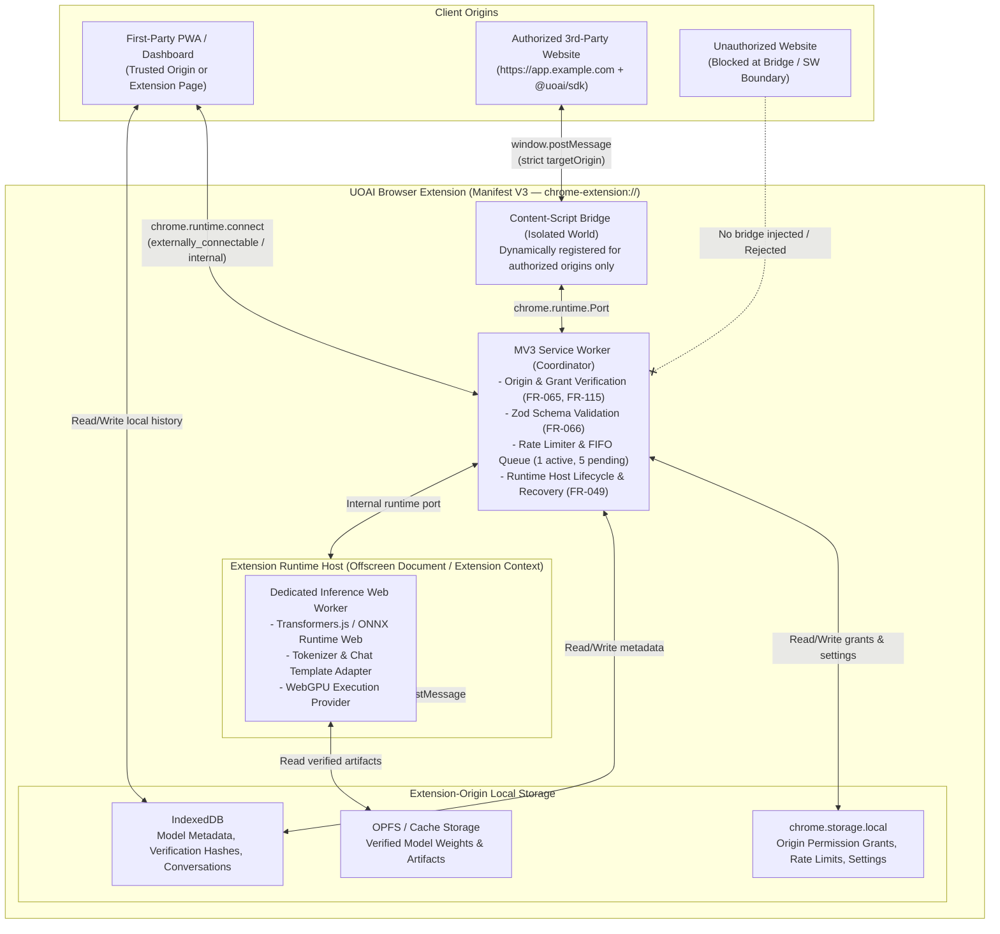

# UOAI — Technical and Solution Architecture Constraints

| Field | Value |
|---|---|
| Document | Technical and Solution Architecture Constraints |
| Version | 0.1 (Draft for review) |
| Parent | [BRD.md](../business/BRD.md) |
| Related | [SCOPE_AND_ASSUMPTIONS.md](../business/SCOPE_AND_ASSUMPTIONS.md), [API_REQUIREMENTS.md](API_REQUIREMENTS.md), [SECURITY_AND_PRIVACY_REQUIREMENTS.md](SECURITY_AND_PRIVACY_REQUIREMENTS.md), [MODEL_COMPATIBILITY_REQUIREMENTS.md](MODEL_COMPATIBILITY_REQUIREMENTS.md), [ARCHITECTURE_DECISIONS.md](../decisions/ARCHITECTURE_DECISIONS.md) |

---

## 1. Mandatory Platform and Architectural Constraints

These constraints are foundational to the extension-only, browser-first product definition and must not be violated by any implementation choice:

1. **Browser-First & Extension-Owned Provider (PC-01, PC-02):**
   - UOAI runs inside Chromium-based browsers via a **Manifest V3 (MV3) browser extension**.
   - End users must **never** be required to install native desktop binaries, OS services, Docker, Python, Node.js, or local HTTP servers.
2. **MV3 Service Worker Is Not an Inference Server (PC-06):**
   - Chromium MV3 Service Workers are ephemeral event handlers terminated after ~30 seconds of inactivity (or ~5 minutes of single request execution) and lack reliable long-lived GPU/Worker hosting semantics.
   - The Service Worker must be used strictly for **message routing, origin & permission validation, request queueing, lifecycle coordination, and recovery**.
   - All model loading, tokenization, and WebGPU inference must run in an **extension-owned execution context hosting a dedicated Web Worker** — specifically, per approved decision **`OQ-02 = Option B`** and **`ADR-002`**, a **visible extension page/tab (`chrome-extension://<id>/app.html`) or extension Side Panel (`chrome.sidePanel`)** acting as the Runtime Host.
3. **No Permanent Localhost TCP/HTTP Server (PC-07, PC-08):**
   - Browser extensions cannot bind TCP listening sockets or expose a real `http://localhost:PORT` server.
   - No documentation, UI, or SDK may promise a `localhost` HTTP endpoint in the extension-only product.
   - All third-party website communication occurs via the `@uoai/sdk` over extension messaging (`externally_connectable` for the trusted first-party PWA origin; isolated-world Content-Script Bridge + `chrome.runtime.Port` for authorized third-party origins; see ADR-004).
4. **Offline-First Operation After Setup (PC-04, PC-05):**
   - After initial extension/PWA install and model download, 100% of application startup, model loading, and inference operations must work with zero internet connectivity.
   - All inference runtime code, WebAssembly binaries, tokenizers, and UI assets must be packaged locally or precached (NFR-016).
   - No silent cloud inference fallback is permitted under any circumstance (BR-02).
5. **Single Storage Origin for Shared Models (ADR-006):**
   - Models must be stored once inside the **extension origin** (`chrome-extension://<id>/`) using OPFS and/or Cache Storage so that all authorized websites and the first-party Workspace share the same downloaded model artifacts without per-site duplication.

---

## 2. High-Level Runtime Architecture



---

## 3. Proposed Technology Direction and Feasibility Analysis

The table below documents the proposed technology stack along with mandatory platform feasibility concerns that must be validated in **Phase 0**.

| Layer | Proposed Technology | Purpose | Feasibility Concerns & Platform Constraints |
|---|---|---|---|
| **Browser Extension Framework** | Manifest V3 + WXT (or equivalent Vite-based MV3 bundler) | Build extension service worker, popup, offscreen document, extension pages, and dynamic content scripts. | Must enforce strict MV3 Content Security Policy (`script-src 'self' 'wasm-unsafe-eval'; object-src 'self'`) with zero remotely hosted code (NFR-016, NFR-017). |
| **Frontend & Dashboard / PWA** | React 18+, TypeScript (strict), Vite, PWA Service Worker (Workbox or equivalent) | Render the 7 Dashboard screens with full offline precaching. | **Dual-origin consideration (OQ-03):** If the Dashboard is hosted at an `https://` PWA origin rather than `chrome-extension://`, IndexedDB/OPFS are partitioned by origin. Model weights **must** stay in the extension origin; the PWA accesses provider state via `externally_connectable` messaging. |
| **Styling & UI System** | Tailwind CSS + accessible headless component primitives | Responsive, minimal UI supporting dark/light modes and WCAG 2.2 AA accessibility. | Must bundle all fonts and icons locally—no Google Fonts or external CDN links (FR-101). |
| **State Management** | Zustand (or equivalent lightweight store) | Client-side UI state synchronized with extension runtime status and IndexedDB. | UI store is ephemeral; source of truth for runtime status and grants resides in the extension coordinator and `chrome.storage.local`. |
| **Schema Validation** | Zod | Runtime validation of all cross-context messages, API payloads, registry manifests, and stored settings. | Must avoid `eval()` / `new Function()` (Zod works without code evaluation, satisfying MV3 CSP). |
| **Inference Engine** | Transformers.js (v3+ WebGPU) and/or ONNX Runtime Web (`ort-web` WebGPU EP) | Local tokenization, model execution, and WebGPU shader dispatch. | - Must bundle `.wasm` runtime binaries locally inside the extension package and configure `env.backends.onnx.wasm.wasmPaths` to local extension URLs.<br>- Must set `env.allowRemoteModels = false` during inference (FR-105).<br>- Not all ONNX operators or quantizations run on WebGPU across all drivers (requires model qualification, see [MODEL_COMPATIBILITY_REQUIREMENTS.md](MODEL_COMPATIBILITY_REQUIREMENTS.md)). |
| **Hardware Acceleration** | WebGPU (`navigator.gpu`) | GPU-accelerated tensor operations. | WebGPU availability in a Web Worker spawned from an MV3 Offscreen Document must be verified across Chrome and Edge on Windows, macOS, and ChromeOS in Phase 0 (TA-01, OQ-02). |
| **Inference Execution Context** | Dedicated Web Worker inside an Extension Offscreen Document (or pinned extension page) | Isolate heavy CPU/GPU tokenization and dispatch from UI and Service Worker threads. | Chromium currently allows only **one** offscreen document per extension at a time, and only exposes restricted APIs (`chrome.runtime`) to offscreen documents. If the worker needs storage access not exposed in offscreen documents, the offscreen host or an extension page must coordinate storage handles (OQ-02, OQ-05). |
| **Large Model File Storage** | Origin Private File System (OPFS) and/or Cache Storage API | Persist multi-gigabyte model weights, tokenizers, and staging downloads. | Requires `unlimitedStorage` manifest permission and `navigator.storage.persist()` (FR-106). OPFS synchronous file handles (`createSyncAccessHandle`) are only available inside dedicated Web Workers. Phase 0 must benchmark OPFS vs. Cache Storage streaming reads with ONNX Runtime Web (OQ-05). |
| **Metadata & Conversations** | IndexedDB | Store installed model records, SHA-256 verification status, and local conversation transcripts. | Must wrap transactions for atomic commit during model installation (FR-019) and complete deletion on reset (FR-121). |
| **Extension Settings & Grants** | `chrome.storage.local` | Store per-origin permission grants, denied origins, rate-limit configs, and onboarding flags. | Accessible directly from the MV3 Service Worker without waking an offscreen document. |
| **Automated Testing** | Vitest (unit/integration) + Playwright (Chromium extension & offline E2E) | Execute TC-001 – TC-045, schema fuzzing, and offline verification. | Headless CI runners often lack physical WebGPU adapters; CI must combine deterministic mock-adapter protocol tests with physical-GPU runner benchmarks on RC-1 – RC-4. |

---

## 4. Proposed Monorepo Repository Structure

UOAI is organized as a modular TypeScript monorepo (e.g., pnpm workspaces) with strict package boundary rules enforced in CI (NFR-030):

```text
uoai/
  apps/
    web/                        # Browser-based Dashboard / PWA (React, Vite, Tailwind, PWA SW)
    extension/                  # Chromium Manifest V3 Extension (SW, Popup, Offscreen Runtime Host, Content Script entry)
  packages/
    inference-core/             # Dedicated Web Worker inference lifecycle, queue execution, WebGPU init & recovery
    model-adapters/             # Transformers.js / ONNX Runtime Web adapters, tokenizers, chat template processors
    model-registry/             # Qualified model catalog manifest schema, signature/hash verifier, compatibility evaluator
    model-storage/              # OPFS / Cache Storage artifact manager, resumable downloader, streaming SHA-256 verifier
    api-protocol/               # Single source of truth: versioned Zod schemas for logical API, messages, chunks, errors
    browser-bridge/             # PostMessage <-> chrome.runtime.Port relay & externally_connectable transport helpers
    sdk/                        # Public @uoai/sdk npm package for third-party web developers
    shared-types/               # Pure TypeScript domain types shared across internal packages
    ui/                         # Reusable accessible React UI component system shared by apps/web and apps/extension
  docs/                         # Authoritative BRD, requirements, product, architecture, decisiones, and developer docs
```

### 4.1 Module Responsibilities and Boundary Rules

| Package / App | Responsibility | Allowed Internal Dependencies | Forbidden Dependencies (Enforced by NFR-030) |
|---|---|---|---|
| `packages/shared-types` | Pure TypeScript interfaces, constants, and brand types (zero runtime bloat). | None | All other packages |
| `packages/api-protocol` | Versioned Zod schemas for logical operations (`/v1/models`, `/v1/chat/completions`, `/v1/health`, `/v1/runtime`, `cancel`), wire envelopes, and `UOAIError` definitions. | `shared-types` | `inference-core`, `model-storage`, `ui`, `apps/*` |
| `packages/model-registry` | Bundled qualified model manifest, remote registry verification, and hardware capability matching logic (`FR-012`). | `shared-types`, `api-protocol` | `inference-core`, `ui`, `sdk`, `apps/*` |
| `packages/model-storage` | Resumable HTTP Range downloader, OPFS/Cache Storage staging and final file management, streaming SHA-256 verification (`FR-018`), and IndexedDB model metadata store. | `shared-types`, `model-registry` | `ui`, `sdk`, `apps/*` |
| `packages/model-adapters` | Per-model-family adapters wrapping Transformers.js / ONNX Runtime Web, tokenizer encode/decode, and chat template formatting (`FR-042`, `FR-043`). | `shared-types`, `model-registry` | `ui`, `sdk`, `browser-bridge`, `apps/*` |
| `packages/inference-core` | Dedicated Web Worker controller, WebGPU adapter/device initialization (`FR-040`), token generation loop, cancellation (`FR-046`), unload, and crash recovery (`FR-049`). | `shared-types`, `api-protocol`, `model-adapters`, `model-storage`, `model-registry` | `ui`, `sdk`, `browser-bridge`, `apps/*` |
| `packages/browser-bridge` | Page-to-content-script `window.postMessage` envelope protocol and content-script-to-SW `chrome.runtime.Port` transport (`FR-067`). | `shared-types`, `api-protocol` | `inference-core`, `model-storage`, `ui`, `apps/*` |
| `packages/sdk` (`@uoai/sdk`) | Public developer SDK exposing `UOAI.connect()`, `ai.models.list()`, `ai.chat.completions.create()`, streaming async iterators, and `UOAIError`. | `shared-types`, `api-protocol`, `browser-bridge` (page client portion only) | `inference-core`, `model-storage`, `model-adapters`, `ui`, `apps/*` |
| `packages/ui` | Shared React component primitives, design tokens, and accessibility helpers. | `shared-types`, `api-protocol` | `inference-core`, `model-storage`, `sdk`, `apps/*` |
| `apps/extension` | MV3 Service Worker gateway, two-layer permission manager, rate limiter, FIFO request queue, Offscreen Runtime Host, and toolbar popup. | All `packages/*` except `sdk` (except in E2E tests) | `apps/web` (unless embedding shared UI routes) |
| `apps/web` | Dashboard / PWA screens (Onboarding, Library, Workspace, Provider Dashboard, Integrations, Developer Console, Settings). | `ui`, `api-protocol`, `shared-types`, `model-registry`, `browser-bridge` / `sdk` | Direct import of `inference-core` worker execution (must route via extension provider) |
