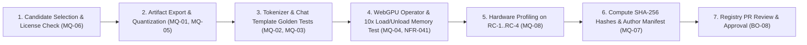

# UOAI — Model Compatibility and Qualification Requirements

| Field | Value |
|---|---|
| Document | Model Compatibility and Qualification Requirements |
| Version | 0.1 (Draft for review) |
| Parent | [BRD.md](../business/BRD.md) |
| Related | [ARCHITECTURE_CONSTRAINTS.md](ARCHITECTURE_CONSTRAINTS.md), [FUNCTIONAL_REQUIREMENTS.md](../requirements/FUNCTIONAL_REQUIREMENTS.md), [NON_FUNCTIONAL_REQUIREMENTS.md](../requirements/NON_FUNCTIONAL_REQUIREMENTS.md), [OPEN_QUESTIONS.md](../decisions/OPEN_QUESTIONS.md) |

---

## 1. Fundamental Scope Boundary

> **No Arbitrary Model Compatibility Promise (X-09, BR-11):**
> UOAI **does not** promise compatibility with arbitrary Hugging Face repositories or every model format (such as arbitrary raw PyTorch `.pt`, safetensors without WebGPU graph export, or GGUF files lacking a qualified browser WebGPU execution adapter).
>
> A model may be offered in the UOAI Model Library **if and only if** it has passed the **8-Stage Model Qualification Process** defined in this document and is published in the verified `packages/model-registry` manifest (BR-11).

---

## 2. Mandatory Model Qualification Criteria

Every model added to `packages/model-registry` must satisfy all eight requirements below:

| # | Qualification Criterion | Technical Requirement | Verification Method |
|---|---|---|---|
| **MQ-01** | **Tested Browser-Compatible Artifact** | Model weights and computation graph are exported in a format executable in-browser by the packaged runtime (`packages/model-adapters` via Transformers.js / ONNX Runtime Web) with zero external Python/native dependencies. | Automated load & inference test in Chromium Web Worker. |
| **MQ-02** | **Supported Tokenizer** | Includes `tokenizer.json` and `tokenizer_config.json` supported by the packaged tokenizer engine, with verified special tokens (BOS, EOS, PAD, turn-end tokens) and multi-byte UTF-8 streaming decode safety (FR-042). | Tokenizer parity test against reference Python tokenizer on 50 golden strings (ASCII, CJK, Devanagari, emoji, code). |
| **MQ-03** | **Supported Chat Template** | Defines a deterministic chat template (Jinja-subset or adapter template function) supporting `system`, `user`, and `assistant` message roles and stop tokens (FR-043). | Golden-file prompt rendering test across single-turn and multi-turn message arrays. |
| **MQ-04** | **Compatible WebGPU Inference Operators** | Every operator in the model graph is supported by the packaged WebGPU execution provider without falling back to unimplemented kernels or throwing shader compilation errors on reference configurations. | End-to-end execution of the benchmark prompt suite on RC-1, RC-2, and RC-3. |
| **MQ-05** | **Defined Quantization** | Uses an explicitly validated quantization scheme (e.g., `q4f16`, `q4`, `int4`, `fp16`) that balances output quality with browser GPU buffer limits. | Perplexity / golden-response sanity check + buffer size verification. |
| **MQ-06** | **Model License Metadata & Legal Review** | Carries explicit license identifier, license version, bundled full license text, attribution string, `requires_acceptance` flag, and cleared distribution method (FR-015, BR-19, OQ-06). | Registry schema check + Legal/Product Owner sign-off. |
| **MQ-07** | **Cryptographic File Integrity Hashes** | Every artifact file (weights shards, tokenizer, config) has its exact byte size and lowercase hex **SHA-256 hash** recorded in the registry manifest (FR-018, BR-08). | Automated streaming SHA-256 verification test (TC-007, TC-008). |
| **MQ-08** | **Declared Hardware & Memory Requirements** | Declares required WebGPU features (e.g., `shader-f16` required vs. optional), minimum WebGPU limits (`maxBufferSize`, `maxStorageBufferBindingSize`), estimated disk size, and estimated peak runtime GPU/system memory (FR-012, FR-048). | Empirical measurement on RC-1 – RC-4 during Phase 0 / qualification benchmark. |

---

## 3. End-to-End Model Qualification Workflow



---

## 4. Registry Manifest Schema (`packages/model-registry`)

Every qualified model entry in the registry must conform to the following structure (validated by Zod at build time and runtime, FR-010, FR-011):

```json
{
  "id": "gemma-4-e2b",
  "name": "Gemma 4 E2B Instruct",
  "version": "1.0.0",
  "Status": "candidate",
  "publisher": "Google",
  "description": "Compact instruction-tuned model candidate for private, on-device drafting, summarization, and Q&A.",
  "adapter": "transformers-js-onnx-webgpu",
  "quantization": "q4f16",
  "context_length": {
    "max_supported": 8192,
    "uoai_default": 4096
  },
  "default_sampling": {
    "temperature": 0.7,
    "top_p": 0.95,
    "stop_sequences": ["<end_of_turn>", "<eos>"]
  },
  "hardware_requirements": {
    "webgpu_required": true,
    "required_features": ["shader-f16"],
    "min_max_buffer_size_bytes": 1073741824,
    "min_max_storage_buffer_binding_size_bytes": 536870912,
    "estimated_download_size_bytes": 1610612736,
    "estimated_runtime_memory_bytes": 2415919104,
    "recommended_system_ram_gb": 8
  },
  "license": {
    "id": "gemma-terms",
    "name": "Gemma Terms of Use",
    "version": "2024-02",
    "requires_acceptance": true,
    "bundled_license_path": "licenses/gemma-terms.txt",
    "attribution": "Gemma is provided under and subject to the Gemma Terms of Use found at ai.google.dev/gemma/terms",
    "restrictions_summary": "Subject to Gemma Terms of Use and Prohibited Use Policy."
  },
  "artifacts": [
    {
      "path": "config.json",
      "url": "https://models.uoai.example/gemma-4-e2b/1.0.0/config.json",
      "size_bytes": 1420,
      "sha256": "<64-char-hex-sha256-to-be-populated-in-phase-0>"
    },
    {
      "path": "tokenizer.json",
      "url": "https://models.uoai.example/gemma-4-e2b/1.0.0/tokenizer.json",
      "size_bytes": 17825792,
      "sha256": "<64-char-hex-sha256-to-be-populated-in-phase-0>"
    },
    {
      "path": "onnx/model_q4f16.onnx_data",
      "url": "https://models.uoai.example/gemma-4-e2b/1.0.0/onnx/model_q4f16.onnx_data",
      "size_bytes": 1592785524,
      "sha256": "<64-char-hex-sha256-to-be-populated-in-phase-0>"
    }
  ],
  "qualification_metadata": {
    "qualified_date": null,
    "tested_reference_configs": ["RC-1", "RC-2", "RC-3"]
  }
}
```

---

## 5. Initial Model Candidate: Gemma 4 E2B Instruct

### 5.1 Candidate Status and Validation Gate

> **IMPORTANT — Candidate Status (BA-05, R-08, OQ-01):**
> The initial primary model candidate specified by the product brief is **Gemma 4 E2B Instruct**.
>
> In accordance with engineering and business integrity guidelines, **Gemma 4 E2B Instruct is treated strictly as an unvalidated candidate until Phase 0 (Feasibility Validation) completes.** No requirement in this BRD assumes that Gemma 4 E2B Instruct has already passed WebGPU operator validation, memory profiling, or license clearance.

### 5.2 Phase 0 Validation Checklist for Gemma 4 E2B Instruct

Before Gemma 4 E2B Instruct can be promoted from `candidate` to `qualified` for the MVP catalog, Phase 0 must verify and document:

1. **Artifact & Architecture Availability:** Confirm availability (or reproducible export) of ONNX / Transformers.js WebGPU-compatible weights (`q4f16` and/or `q4` quantization) for the exact Gemma 4 E2B Instruct architecture (including any architectural features such as Per-Layer Embeddings, sliding/global attention kernels, or multimodal projection layers if present in the E2B checkpoint).
2. **WebGPU Operator Coverage:** Verify that the packaged ONNX Runtime Web / Transformers.js WebGPU backend executes all graph nodes on RC-1 (Windows discrete GPU), RC-2 (macOS Apple Silicon), and RC-3 (Windows integrated GPU) without missing-kernel errors.
3. **Shard & Buffer Sizing vs. Browser Limits:** Standard Chromium WebGPU limits often restrict single storage buffer bindings (`maxStorageBufferBindingSize`, e.g., 128 MB – 1 GB on some integrated GPUs) and `maxBufferSize`. Phase 0 must verify that the quantized tensor allocations fit within RC-3 limits.
4. **License & Distribution Terms Review (OQ-06):** Verify the applicable Gemma license terms regarding:
   - Required click-through acceptance before download (supported by FR-015, BR-19),
   - Required attribution and prohibited-use notices in the UI,
   - Whether artifacts must be fetched directly from an official upstream repository or may be hosted on a UOAI CDN mirror.
5. **Fallback Model Contingency (R-08):** If Gemma 4 E2B Instruct fails any of items 1–4 during Phase 0, the Architecture Lead and Product Owner will qualify an already-proven browser-WebGPU open-weights fallback candidate (such as a qualified `q4f16` build of Gemma 2 2B Instruct, Qwen 2.5 1.5B/3B Instruct, Llama 3.2 1B/3B Instruct, or SmolLM2 1.7B Instruct) using the exact same MQ-01 – MQ-08 qualification gate so MVP delivery is not blocked (OQ-01).
