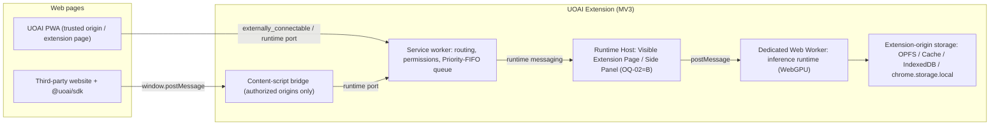

# Universal Offline AI (UOAI) — Business Requirements Document

| Field | Value |
|---|---|
| Document | Business Requirements Document (BRD) — master document |
| Product | Universal Offline AI (UOAI) |
| Version | 0.1 |
| Status | **Draft — For Review and Approval** |
| Date | 2026-11-24 |
| Document owner | Product Owner (to be named — OQ-19) |
| Approvers | Product Owner, Business Sponsor, Architecture Lead, Security Lead, QA Lead |
| Classification | Internal / Public-ready after review |

### Revision history

| Version | Date | Author | Change |
|---|---|---|---|
| 0.1 | 2026-11-24 | Business Analysis / Product | Initial draft of full BRD package. |
| 0.2 | 2026-11-24 | Business Analysis / Product | Incorporated stakeholder decisions on all 22 Open Questions (`OQ-01` – `OQ-22`) and promoted `ADR-001` – `ADR-012` to Accepted. |

### Repository baseline

At the time of writing, the repository (`UOAI Web`) was **empty** — there was no code, documentation, or configuration. So there were **no existing work products to preserve** and **no contradictions between existing code and these requirements**. Contradictions and tensions *within the product brief itself* are recorded as open decisions in [OPEN_QUESTIONS.md](../decisions/OPEN_QUESTIONS.md) (see §17).

---

## Document Map

This BRD is the authoritative entry point. Detailed, ID-level requirements live in the supporting documents below. **Where this summary and a supporting document differ, the supporting document is authoritative for its own IDs**, and the difference must be logged as a defect against this BRD.

| Area | Document | Contents |
|---|---|---|
| Business | [BUSINESS_OBJECTIVES.md](BUSINESS_OBJECTIVES.md) | BO-01 – BO-08 with measurable indicators |
| Business | [STAKEHOLDERS_AND_PERSONAS.md](STAKEHOLDERS_AND_PERSONAS.md) | SH-01 – SH-12, RACI, personas P1 – P5 |
| Business | [SCOPE_AND_ASSUMPTIONS.md](SCOPE_AND_ASSUMPTIONS.md) | In/out of scope, assumptions, dependencies, constraints, known limitations |
| Business | [BUSINESS_RULES.md](BUSINESS_RULES.md) | BR-01 – BR-24 (non-negotiable vs configurable) |
| Business | [SUCCESS_METRICS.md](SUCCESS_METRICS.md) | KPI-01 – KPI-15, privacy-safe measurement |
| Requirements | [FUNCTIONAL_REQUIREMENTS.md](../requirements/FUNCTIONAL_REQUIREMENTS.md) | FR-001 – FR-124 (10 modules) |
| Requirements | [NON_FUNCTIONAL_REQUIREMENTS.md](../requirements/NON_FUNCTIONAL_REQUIREMENTS.md) | NFR-001 – NFR-048, reference configurations |
| Requirements | [USE_CASES.md](../requirements/USE_CASES.md) | UC-01 – UC-15 with sequence diagrams |
| Requirements | [USER_JOURNEYS.md](../requirements/USER_JOURNEYS.md) | UJ-01 – UJ-08 end-to-end journeys |
| Requirements | [ACCEPTANCE_CRITERIA.md](../requirements/ACCEPTANCE_CRITERIA.md) | MVP-AC-01 – MVP-AC-17, test cases TC-001 – TC-045 |
| Requirements | [TRACEABILITY_MATRIX.md](../requirements/TRACEABILITY_MATRIX.md) | BO → FR → NFR → UC → AC → TC → Phase |
| Product | [PRODUCT_VISION.md](../product/PRODUCT_VISION.md) | Vision, mission, positioning, differentiators |
| Product | [UX_REQUIREMENTS.md](../product/UX_REQUIREMENTS.md) | Information architecture, 7 screens, state requirements |
| Product | [PRODUCT_ROADMAP.md](../product/PRODUCT_ROADMAP.md) | Phases 0 – 6, deliverables, exit criteria, T-shirt sizes |
| Product | [RISKS_AND_DEPENDENCIES.md](../product/RISKS_AND_DEPENDENCIES.md) | Risk register R-01 – R-16 |
| Architecture | [ARCHITECTURE_CONSTRAINTS.md](../architecture/ARCHITECTURE_CONSTRAINTS.md) | Platform constraints, technology direction, feasibility concerns, monorepo |
| Architecture | [API_REQUIREMENTS.md](../architecture/API_REQUIREMENTS.md) | Logical API, SDK, formats, errors, lifecycle, versioning |
| Architecture | [SECURITY_AND_PRIVACY_REQUIREMENTS.md](../architecture/SECURITY_AND_PRIVACY_REQUIREMENTS.md) | Threat model T-01 – T-12, data classification, compliance considerations |
| Architecture | [MODEL_COMPATIBILITY_REQUIREMENTS.md](../architecture/MODEL_COMPATIBILITY_REQUIREMENTS.md) | Model qualification process, manifest, candidate model |
| Decisions | [OPEN_QUESTIONS.md](../decisions/OPEN_QUESTIONS.md) | OQ-01 – OQ-22 unresolved decisions |
| Decisions | [ARCHITECTURE_DECISIONS.md](../decisions/ARCHITECTURE_DECISIONS.md) | ADR-001 – ADR-012 |
| Developer | [INTEGRATION_GUIDE.md](../developer/INTEGRATION_GUIDE.md) | Website & MV3 extension integration guide (`@uoai/sdk`) |
| Developer | [AI_INTEGRATION_PROMPT.md](../developer/AI_INTEGRATION_PROMPT.md) | Copy-and-paste prompts for integrating UOAI into existing websites & extensions |

### Requirement ID conventions

| Prefix | Meaning | Defined in |
|---|---|---|
| BO-xx | Business objective | BUSINESS_OBJECTIVES.md |
| SH-xx / P1–P5 | Stakeholder / persona | STAKEHOLDERS_AND_PERSONAS.md |
| BR-xx | Business rule | BUSINESS_RULES.md |
| FR-xxx | Functional requirement (numbered in blocks of 10 per module, so gaps are intentional) | FUNCTIONAL_REQUIREMENTS.md |
| NFR-xxx | Non-functional requirement | NON_FUNCTIONAL_REQUIREMENTS.md |
| UC-xx / UJ-xx | Use case / user journey | USE_CASES.md / USER_JOURNEYS.md |
| MVP-AC-xx / TC-xxx | MVP acceptance criterion / test case | ACCEPTANCE_CRITERIA.md |
| R-xx | Risk | RISKS_AND_DEPENDENCIES.md |
| T-xx | Threat | SECURITY_AND_PRIVACY_REQUIREMENTS.md |
| OQ-xx / ADR-xxx | Open question / architecture decision | decisions/ |
| KPI-xx | Success metric | SUCCESS_METRICS.md |

### Normative language

- **Must / Must Have** — mandatory for MVP acceptance.
- **Should / Should Have** — expected in MVP; can be deferred only with Product Owner approval.
- **Could / Could Have** — desirable; included if capacity allows.
- **Won't Have (MVP)** — explicitly excluded from MVP; recorded for future consideration.
- **Recommendation** — advice from the analysis team; not a requirement until approved.
- **Assumption** — believed true; must be validated (mostly in Phase 0).

---

## 1. Executive Summary

**What UOAI is.** Universal Offline AI (UOAI) is a privacy-first, local AI provider that runs inside the user's Chromium-based browser. It is delivered as a **Manifest V3 browser extension** plus a **browser-based dashboard/PWA**. Users download a qualified AI model once. After that, the model runs **locally on their device using WebGPU**, with **no internet connection required**.

**Why it is needed.** Today's mainstream AI assistants and APIs depend on cloud inference. That brings recurring costs, a need for connectivity, API-key management, vendor lock-in, and the transfer of potentially sensitive prompts to third parties. Existing local-AI tools usually need native installs (runtimes, Docker, Python, local servers), which non-technical users and most website visitors will not do.

**Business opportunity.** WebGPU in Chromium browsers and maturing in-browser runtimes (Transformers.js, ONNX Runtime Web) make it possible to run small and medium language models in the browser. No widely adopted, permissioned, **browser-native "local AI provider"** currently lets any website use the user's own local model through a standard API. UOAI aims to become that provider layer.

**Primary value proposition.**
- Private: prompts and outputs stay on the device (BO-01).
- Offline: works without internet after setup (BO-02).
- Accessible: guided setup for non-technical users (BO-03).
- Developer-friendly: an OpenAI-inspired TypeScript SDK with streaming and cancellation (BO-04).
- User-controlled: websites get access only with explicit, per-origin, revocable permission (BO-05).
- Honest: clear detection and explanation of browser and hardware limits (BO-06).
- No API keys, accounts, or per-token fees for local inference (BO-07).

**Target users.** Non-technical individuals, web developers, privacy-conscious professionals, organization administrators, and open-source contributors (see [STAKEHOLDERS_AND_PERSONAS.md](STAKEHOLDERS_AND_PERSONAS.md)).

**Expected outcomes (MVP).** A user can install the extension, pass capability checks, download and verify a qualified model, chat locally, go offline, reopen UOAI, and still generate responses. An authorized third-party website can make streaming, cancellable local inference requests through the SDK. Unauthorized websites are rejected, and no prompt reaches a cloud inference provider (see [ACCEPTANCE_CRITERIA.md](../requirements/ACCEPTANCE_CRITERIA.md)).

**Major differentiators.**
1. A browser-native provider model: one local model shared by many websites under user control.
2. Nothing to install beyond a browser extension: no Docker, Python, Node.js, or local server.
3. An OpenAI-inspired logical API over secure extension messaging, without pretending to be a localhost server.
4. A curated, integrity-verified, license-aware model catalog.
5. Honest capability detection instead of silent failure or hidden cloud fallback.

---

## 2. Business Background and Problem Statement

| # | Problem | Impact | How UOAI addresses it |
|---|---|---|---|
| PB-01 | **Dependence on internet connectivity** — cloud AI fails offline or on poor networks. | No AI on flights, trains, rural areas, or restricted networks. | Offline-first operation after setup (FR-100 – FR-108). |
| PB-02 | **Recurring cloud inference costs** — per-token pricing grows with usage. | Developers hesitate to offer AI features; users pay subscriptions. | Inference runs on the user's hardware at no per-request cost (BO-07). |
| PB-03 | **Privacy and data-sharing concerns** — prompts may be logged, retained, or used for training. | Professionals with sensitive data avoid AI; compliance friction. | Local-only inference, no prompt telemetry, local storage only (BR-01, BR-05). |
| PB-04 | **API key management** — keys must be issued, stored, rotated, and protected. | Security incidents; poor user experience for "bring your own key". | No keys needed; access is controlled by browser-mediated, per-origin permissions (FR-061). |
| PB-05 | **Vendor lock-in** — applications are coupled to a single provider's API and pricing. | Migration costs; pricing risk. | OpenAI-inspired API shape reduces switching cost; open model catalog (FR-074). |
| PB-06 | **Limited user control over AI execution** — users can't see or control where AI runs. | Distrust; no ability to revoke. | Provider dashboard, runtime status, authorized-site list, instant revocation (FR-047, FR-063, FR-064). |
| PB-07 | **Difficulty integrating private local AI into websites** — local servers need native installs and CORS/port configuration. | Websites can't use local AI for ordinary visitors. | Extension provider + SDK + content-script bridge; no native install (FR-067, FR-070). |

**Problem statement.** *Users and developers lack a private, offline-capable, install-light way to use AI in web applications. Cloud APIs create cost, connectivity, privacy, and key-management burdens. Existing local-AI options need native software that most users will not install.* UOAI addresses this with a browser-resident, permissioned local AI provider.

---

## 3. Product Vision, Mission, and Objectives

- **Vision:** *Every browser can be a private AI computer, so any website can offer AI that runs on the user's own device, under the user's control.*
- **Mission:** *Make local, offline, private AI available to everyday users and web developers through a browser extension, a simple dashboard, and a familiar developer API, without cloud dependence, accounts, or API keys.*

Objectives BO-01 – BO-08 and their measurable success indicators are in [BUSINESS_OBJECTIVES.md](BUSINESS_OBJECTIVES.md). Positioning and differentiators are in [PRODUCT_VISION.md](../product/PRODUCT_VISION.md).

| Lens | Objectives | Headline indicator |
|---|---|---|
| Business | BO-07, BO-08 | 0 keys/accounts required; 100% catalog license compliance |
| User | BO-03, BO-06 | ≥ 80% unassisted setup-to-first-inference in usability tests |
| Developer | BO-04 | Median ≤ 30 min to working streaming integration |
| Privacy | BO-01, BO-05 | 0 prompt egress; 100% unauthorized rejection |
| Offline | BO-02 | ≥ 95% offline launch-and-generate success on reference configurations |

---

## 4. Stakeholders

Twelve stakeholder groups (SH-01 – SH-12) are defined with interests, responsibilities, expectations, influence, and a RACI matrix in [STAKEHOLDERS_AND_PERSONAS.md](STAKEHOLDERS_AND_PERSONAS.md). Key release gatekeepers: **Product Owner**, **Security & Privacy**, **Browser store reviewers**, and **Legal counsel** (a legal assessment has **not** yet been performed).

## 5. User Personas

| Persona | Summary | Primary journeys |
|---|---|---|
| P1 Maya — non-technical user | Wants simple, offline, private chat | UJ-01, UJ-04 |
| P2 Arjun — web developer | Wants OpenAI-like local AI in his web app, no keys | UJ-02 |
| P3 Dr. Lena — privacy professional | Wants verifiable local-only use and revocation | UJ-03 |
| P4 Ravi — enterprise admin | Wants governance; policies are future scope | UJ-07 |
| P5 Sam — OSS contributor | Wants a clear model qualification path | UJ-08 |

Full personas: [STAKEHOLDERS_AND_PERSONAS.md](STAKEHOLDERS_AND_PERSONAS.md).

## 6. Scope

**In scope (MVP):** Chromium MV3 extension provider; dashboard/PWA; local model management with integrity verification; WebGPU inference in a dedicated worker; local chat workspace; offline operation after setup; OpenAI-inspired TypeScript SDK; per-origin website authorization; streaming; cancellation; runtime management; permission management; basic developer console; local conversation history; error handling and capability detection.

**Out of scope (MVP):** native desktop app; always-running OS AI server; guaranteed localhost HTTP endpoint; cloud inference; mandatory accounts; cloud sync; multi-device model sync; iOS/Safari; arbitrary model-format compatibility; guaranteed support for all GPUs/browsers; enterprise managed policies; Firefox; multimodal/embeddings/tool calling.

Details, assumptions, dependencies, constraints, and known limitations: [SCOPE_AND_ASSUMPTIONS.md](SCOPE_AND_ASSUMPTIONS.md).

## 7. Functional Requirements

96 functional requirements in 10 modules: [FUNCTIONAL_REQUIREMENTS.md](../requirements/FUNCTIONAL_REQUIREMENTS.md).

| Module | ID range | Count |
|---|---|---|
| 7.1 Onboarding and Setup | FR-001 – FR-008 | 8 |
| 7.2 Model Library | FR-010 – FR-023 | 14 |
| 7.3 Local AI Workspace | FR-030 – FR-038 | 9 |
| 7.4 Inference Runtime | FR-040 – FR-051 | 12 |
| 7.5 Universal Website Integration | FR-060 – FR-068 | 9 |
| 7.6 Developer SDK and API | FR-070 – FR-081 | 12 |
| 7.7 Developer Console | FR-090 – FR-097 | 8 |
| 7.8 Offline Management | FR-100 – FR-108 | 9 |
| 7.9 Privacy and Security | FR-110 – FR-119 | 10 |
| 7.10 Settings and Data Controls | FR-120 – FR-124 | 5 |

## 8. Non-Functional Requirements

48 NFRs across performance, reliability, availability, offline, security, privacy, usability, accessibility, maintainability, scalability, compatibility, storage efficiency, resource management, recovery, and privacy-preserving observability: [NON_FUNCTIONAL_REQUIREMENTS.md](../requirements/NON_FUNCTIONAL_REQUIREMENTS.md). Hardware-dependent performance is specified through **reference configurations (RC-1 – RC-4) and a measurement methodology**, not universal guarantees.

## 9. User Journeys and Use Cases

- 15 detailed use cases (UC-01 – UC-15), with Mermaid sequence diagrams: [USE_CASES.md](../requirements/USE_CASES.md).
- 8 end-to-end persona journeys (UJ-01 – UJ-08): [USER_JOURNEYS.md](../requirements/USER_JOURNEYS.md).

## 10. Product UX Requirements

Information architecture and per-screen requirements (purpose, components, actions, loading/empty/error/offline states, accessibility) for Onboarding, Model Library, AI Workspace, Provider Dashboard, Website Integrations, Developer Console, and Settings & Privacy: [UX_REQUIREMENTS.md](../product/UX_REQUIREMENTS.md).

## 11. Technical and Solution Constraints

Mandatory platform constraints, the proposed technology direction (WXT, React/TypeScript, Vite PWA, Tailwind, Zustand, Zod, Transformers.js/ONNX Runtime Web, WebGPU, dedicated Worker, OPFS/Cache Storage, IndexedDB, `chrome.storage.local`, Vitest/Playwright), feasibility concerns, and the proposed monorepo structure: [ARCHITECTURE_CONSTRAINTS.md](../architecture/ARCHITECTURE_CONSTRAINTS.md).

Model qualification process and the **candidate** (not validated) initial model, Gemma 4 E2B Instruct: [MODEL_COMPATIBILITY_REQUIREMENTS.md](../architecture/MODEL_COMPATIBILITY_REQUIREMENTS.md).

## 12. API and Integration Requirements

The OpenAI-inspired **logical** operations (`GET /v1/models`, `POST /v1/chat/completions`, `GET /v1/health`, `GET /v1/runtime`, plus cancellation) are exposed **through the SDK and extension messaging transport, not as HTTP endpoints**. Request, response, streaming, and error formats, plus cancellation, model identifiers, connection lifecycle, permission behaviour, and versioning: [API_REQUIREMENTS.md](../architecture/API_REQUIREMENTS.md).

## 13. Business Rules

25 rules (`BR-01` – `BR-25`), each labelled **Non-negotiable (NN)**, **Configurable policy (CP)**, or **Operational (OP)**: [BUSINESS_RULES.md](BUSINESS_RULES.md).

## 14. Security, Privacy, and Compliance

Threat model (malicious websites, unauthorized messaging, cross-origin attacks, prompt injection, malformed requests, resource exhaustion, artifact tampering, storage exhaustion, extension compromise, data leakage), mitigations, residual risks, data classification, storage locations, retention, deletion controls, disclosures, and license/store-policy considerations: [SECURITY_AND_PRIVACY_REQUIREMENTS.md](../architecture/SECURITY_AND_PRIVACY_REQUIREMENTS.md). **No legal compliance is claimed** pending legal assessment.

## 15. Assumptions, Dependencies, and Constraints

See [SCOPE_AND_ASSUMPTIONS.md](SCOPE_AND_ASSUMPTIONS.md) §3 – §9 and [RISKS_AND_DEPENDENCIES.md](../product/RISKS_AND_DEPENDENCIES.md). Highlighted limitations:

- WebGPU availability varies (KL-01).
- Browser storage may be evicted (KL-02).
- Model memory requirements depend on model and device (KL-03).
- Extension execution contexts have lifecycle limitations (KL-04).
- The extension-only architecture provides **no permanent localhost HTTP server** (KL-05).
- Closing the active inference runtime (visible extension page/tab or side panel) or the browser stops active inference (KL-06).
- Offline readiness depends on all required assets being downloaded and cached (KL-07).

## 16. Success Metrics and KPIs

KPI-01 – KPI-15, with privacy-safe measurement (zero remote telemetry endpoints in MVP per `OQ-12 = Option A`; prompts/responses never collected): [SUCCESS_METRICS.md](SUCCESS_METRICS.md).

## 17. Acceptance Criteria and MVP Definition

17 MVP acceptance criteria (MVP-AC-01 – MVP-AC-17) with testable criteria and test cases TC-001 – TC-045: [ACCEPTANCE_CRITERIA.md](../requirements/ACCEPTANCE_CRITERIA.md).

## 18. Risks and Mitigation Plan

Risk register R-01 – R-16 with probability, impact, severity, mitigation, contingency, and owner: [RISKS_AND_DEPENDENCIES.md](../product/RISKS_AND_DEPENDENCIES.md).

## 19. Delivery Roadmap

Phases 0 – 6 (Feasibility → Inference Engine → Model Management → Extension Provider → PWA Workspace → Developer Ecosystem → Production Readiness), with objectives, deliverables, dependencies, exit criteria, key risks, and T-shirt effort sizes. No calendar dates or team capacity are assumed: [PRODUCT_ROADMAP.md](../product/PRODUCT_ROADMAP.md).

## 20. Requirements Traceability

[TRACEABILITY_MATRIX.md](../requirements/TRACEABILITY_MATRIX.md) links every business objective to functional and non-functional requirements, use cases, MVP acceptance criteria, test cases, and delivery phases.

## 21. Open Questions and Decisions

- **Resolved decisions `OQ-01` – `OQ-22`** (all 22 options formally selected and locked): [OPEN_QUESTIONS.md](../decisions/OPEN_QUESTIONS.md).
- **Architecture decisions `ADR-001` – `ADR-012`** (all 12 Accepted): [ARCHITECTURE_DECISIONS.md](../decisions/ARCHITECTURE_DECISIONS.md).

### 21.1 Confirmed constraints vs. approved decisions vs. assumptions

| Category | Examples | Where recorded |
|---|---|---|
| **Confirmed constraints** (from product brief) | Chromium + MV3 extension; WebGPU; offline after setup; service worker is not the inference server; no localhost server; logical API via SDK; per-origin permissions; no silent cloud fallback | SCOPE_AND_ASSUMPTIONS §8 (PC-01 – PC-10); ADR-001, ADR-003, ADR-004, ADR-010, ADR-011 |
| **Approved product & architecture decisions** (`OQ-01` – `OQ-22`) | Qualify Gemma 4 E2B Instruct + lightweight <1 GB fallback (`OQ-01=B`); visible extension page/tab or side panel hosting the dedicated Inference Web Worker (`OQ-02=B`); dual UI deployment in extension + hosted PWA (`OQ-03=A`); toolbar popup + `web_accessible_resources` consent page (`OQ-04=A+B`); OPFS download staging & SHA-256 verification (`OQ-05=C`, `OQ-09=A`); per-artifact hosting URLs (`OQ-06=B`); strict WebGPU-only in MVP (`OQ-07=A`); WebCrypto signed registry updates (`OQ-08=A`); Priority-FIFO queue favoring Workspace (`OQ-10=B`); immediate cancel on model switch (`OQ-11=A`); zero remote telemetry in MVP (`OQ-12=A`); website auto-load when idle (`OQ-13=A`); top-level frames only (`OQ-15=A`); Apache-2.0/MIT license & 100% free MVP (`OQ-18=A`) | OPEN_QUESTIONS (OQ-01 – OQ-22); ADR-002, ADR-005 – ADR-009, ADR-012; BUSINESS_RULES (BR-01 – BR-25) |
| **Assumptions** (validated in Phase 0) | Candidate model artifact operator coverage; storage quota behavior; HTTP Range support; user willingness to download GBs | SCOPE_AND_ASSUMPTIONS §3 – §4 |

## 22. Approval

| Role | Name | Decision | Date |
|---|---|---|---|
| Product Owner | _TBD_ | ☐ Approve ☐ Approve with changes ☐ Reject | |
| Business Sponsor | _TBD_ | ☐ | |
| Architecture Lead | _TBD_ | ☐ | |
| Security & Privacy Lead | _TBD_ | ☐ | |
| QA Lead | _TBD_ | ☐ | |
