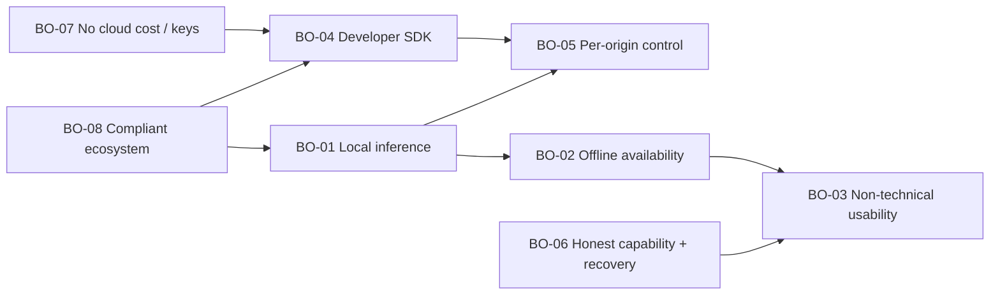

# UOAI — Business Objectives

| Field | Value |
|---|---|
| Document | Business Objectives |
| Product | Universal Offline AI (UOAI) |
| Version | 0.1 (Draft for review) |
| Status | Proposed — awaiting Product Owner approval |
| Parent | [BRD.md](BRD.md) |
| Related | [PRODUCT_VISION.md](../product/PRODUCT_VISION.md), [SUCCESS_METRICS.md](SUCCESS_METRICS.md), [TRACEABILITY_MATRIX.md](../requirements/TRACEABILITY_MATRIX.md) |

---

## 1. Purpose

This document defines the measurable business objectives (BO-xx) that justify UOAI. Every functional requirement (FR), non-functional requirement (NFR), use case (UC), and MVP acceptance criterion (MVP-AC) must trace back to at least one objective (see [TRACEABILITY_MATRIX.md](../requirements/TRACEABILITY_MATRIX.md)).

> **Measurement principle.** UOAI is privacy-first and offline-first. Many indicators are therefore measured in a **controlled test lab** or through **opt-in, aggregate, content-free** product analytics (see [SUCCESS_METRICS.md](SUCCESS_METRICS.md)). No indicator may require collecting prompts, generated responses, or model inputs.

## 2. Objective Catalogue

| ID | Category | Objective | Measurable success indicator (MVP) | Measurement source |
|---|---|---|---|---|
| **BO-01** | Privacy | Run all AI inference on the user's device by default. | 100% of inference requests in the release test suite run locally; 0 bytes of prompt/response content sent to any external host during network-audit tests. | Network audit tests (TC-033, TC-034) |
| **BO-02** | Offline availability | After setup, users can launch UOAI and run inference with no internet connection. | ≥ 95% of offline launch-and-generate attempts succeed on each reference configuration (RC-1 to RC-3); offline readiness indicator is correct in 100% of offline test scenarios. | Test lab (TC-015 – TC-018) |
| **BO-03** | User | Make local AI usable by non-technical users. | ≥ 80% of moderated usability participants (non-technical persona) complete setup through first successful inference without assistance (excluding model download wait time). | Usability study |
| **BO-04** | Developer | Let developers add local AI to websites through a familiar, OpenAI-inspired SDK. | Median time for a developer to integrate a working streaming chat call using docs ≤ 30 minutes in a developer study; SDK request/response shapes pass the compatibility conformance suite. | Developer study, SDK conformance tests |
| **BO-05** | Privacy / Control | Give users explicit, per-origin control over which websites can use their local AI. | 100% of requests from unauthorized origins rejected; revocation blocks 100% of subsequent requests from the revoked origin. | Security tests (TC-027 – TC-030) |
| **BO-06** | Reliability / Honesty | Detect and clearly communicate browser, hardware, and runtime limitations; recover from failures. | 100% of unsupported environments in the compatibility matrix produce an explanatory message; runtime recovers automatically from an induced worker crash in ≥ 95% of trials. | Compatibility matrix, fault-injection tests |
| **BO-07** | Business / Cost | Remove mandatory cloud APIs, accounts, subscriptions, and API keys for local inference. | 0 accounts or API keys required for any MVP local-inference flow. | Acceptance review |
| **BO-08** | Ecosystem / Compliance | Build a sustainable, license-compliant open ecosystem for models and contributors. | 100% of catalog models carry reviewed license metadata and integrity hashes; third-party OSS notices shipped with every release; a documented model qualification process exists. | Release checklist, registry audit |

## 3. Objectives by Stakeholder Lens

### 3.1 Business objectives
- **BO-07** — No recurring per-request inference cost for users or integrating developers.
- **BO-08** — Lawful distribution of models and software; reduce legal and store-rejection risk.
- Establish UOAI as a reference "local AI provider" for browser applications (qualitative; tracked through developer adoption KPIs, see [SUCCESS_METRICS.md](SUCCESS_METRICS.md)).

### 3.2 User objectives
- **BO-03** — Simple, guided setup with plain-language explanations.
- **BO-02** — Dependable offline use after setup.
- **BO-06** — Honest communication when a device cannot run a model.

### 3.3 Developer objectives
- **BO-04** — An SDK whose chat-completion surface mirrors the OpenAI Chat Completions shape, with TypeScript types, streaming, and cancellation.
- Predictable, documented error codes and connection lifecycle.

### 3.4 Privacy objectives
- **BO-01** — Local-only inference by default; no silent cloud fallback.
- **BO-05** — Explicit, revocable, transparent per-origin access.
- No prompt telemetry (see BR-05, FR-114).

### 3.5 Offline availability objectives
- **BO-02** — All application assets, inference runtime code, tokenizers, configurations, and weights for an installed model are available locally.
- Users are told honestly that browser storage can be evicted and are given a way to request persistent storage (FR-106).

## 4. Objective Relationships

## 5. Objective Status

All objectives are **Proposed**. Targets marked "≥" or "≤" are initial MVP targets and must be re-baselined after **Phase 0 — Feasibility Validation** (see [PRODUCT_ROADMAP.md](../product/PRODUCT_ROADMAP.md)). Hardware-dependent performance targets are defined in [NON_FUNCTIONAL_REQUIREMENTS.md](../requirements/NON_FUNCTIONAL_REQUIREMENTS.md) using reference configurations rather than universal guarantees.
