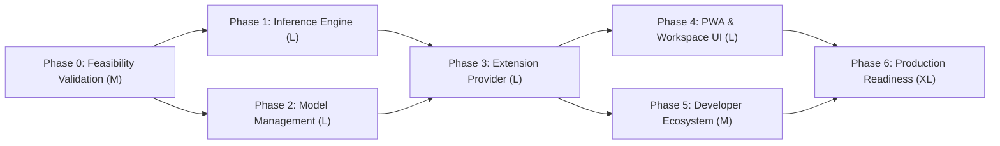

# UOAI — Product Delivery Roadmap

| Field | Value |
|---|---|
| Document | Phased Product Delivery Roadmap |
| Version | 0.1 (Draft for review) |
| Parent | [BRD.md](../business/BRD.md) |
| Related | [RISKS_AND_DEPENDENCIES.md](RISKS_AND_DEPENDENCIES.md), [ACCEPTANCE_CRITERIA.md](../requirements/ACCEPTANCE_CRITERIA.md), [TRACEABILITY_MATRIX.md](../requirements/TRACEABILITY_MATRIX.md), [OPEN_QUESTIONS.md](../decisions/OPEN_QUESTIONS.md) |

---

## 1. Planning Principles

1. **No invented calendar dates or team capacity:** All phases are estimated using relative **T-shirt effort sizes** (`S`, `M`, `L`, `XL`) and sequenced by technical dependencies and risk reduction.
2. **Validate feasibility before scaling UI/SDK work:** **Phase 0 (Feasibility Validation)** is a mandatory gate to resolve high-severity platform and model assumptions (TA-01 – TA-06, OQ-01 – OQ-05) before committing to full feature build.
3. **Every phase has verifiable exit criteria:** A phase is complete only when its mapped test cases and exit criteria pass.

### 1.1 Relative Effort Legend

| T-Shirt Size | Relative Complexity & Scope |
|---|---|
| **S (Small)** | Focused spike or self-contained module with low cross-package coupling. |
| **M (Medium)** | Single core subsystem with well-defined interfaces and automated tests. |
| **L (Large)** | Multi-package subsystem involving browser platform lifecycle, WebGPU, or cross-origin security boundaries. |
| **XL (Extra Large)** | Comprehensive end-to-end UI or cross-platform hardening, security auditing, and compatibility matrix execution. |

---

## 2. Roadmap Overview

| Phase | Name | Relative Effort | Primary Focus | Key Decisions Resolved Before Exit |
|---|---|---|---|---|
| **Phase 0** | Feasibility Validation | **M** | Prove WebGPU in MV3 worker, candidate model qualification, OPFS/Cache storage quota, messaging bridge, and offline execution. | OQ-01, OQ-02, OQ-03, OQ-04, OQ-05, OQ-07, OQ-09, OQ-16 |
| **Phase 1** | Inference Engine | **L** | Build `packages/inference-core` & `packages/model-adapters`: load, tokenize, chat template, generate, stream, cancel, unload, recover. | OQ-10, OQ-11 |
| **Phase 2** | Model Management | **L** | Build `packages/model-registry` & `packages/model-storage`: catalog, downloads, pause/resume, streaming SHA-256 verification, atomic install, eviction detection. | OQ-08, OQ-17 |
| **Phase 3** | Browser Extension Provider | **L** | Build `apps/extension`, `packages/api-protocol`, & `packages/browser-bridge`: MV3 gateway, Runtime Host lifecycle, two-layer permissions, origin/schema validation, rate/queue limits. | OQ-13, OQ-14, OQ-15 |
| **Phase 4** | PWA & Dashboard Workspace | **L** | Build `apps/web` & `packages/ui`: Onboarding, Model Library UI, AI Workspace, Provider Dashboard, Website Integrations UI, Settings & Privacy, offline precache. | OQ-12 |
| **Phase 5** | Developer Ecosystem | **M** | Build `packages/sdk`, Developer Console, reference third-party test website, and developer documentation (`docs/`). | OQ-20 |
| **Phase 6** | Production Readiness | **XL** | Security penetration & fuzz testing, cross-browser compatibility matrix, performance benchmarking, accessibility audit, legal/license sign-off, store release prep. | OQ-06, OQ-18, OQ-19, OQ-21, OQ-22 |

---

## 3. Detailed Phase Specifications

### Phase 0 — Feasibility Validation (Effort: M)

| Attribute | Detail |
|---|---|
| **Objectives** | Empirical validation of technical assumptions TA-01 – TA-06: prove that an MV3 extension can host a dedicated Web Worker with WebGPU access, store and verify a multi-GB model in extension-origin storage, run the candidate model (Gemma 4 E2B Instruct or fallback candidate) offline, and stream tokens to a web page over a content-script bridge. |
| **Deliverables** | 1. **MV3 + WebGPU Spike Prototype:** Comparison of Offscreen Document (`WORKERS` reason) vs. extension page hosting a dedicated Web Worker with WebGPU on Chrome and Edge. 2. **Candidate Model Qualification Report:** Validation of Gemma 4 E2B Instruct (or alternative candidate) ONNX/Transformers.js artifacts, tokenizer parity, chat template, VRAM usage, and license terms. 3. **Storage & Quota Spike Report:** Empirical test of multi-GB writes in OPFS vs. Cache Storage under `chrome-extension://` origin with `unlimitedStorage` and `navigator.storage.persist()`. 4. **Messaging Latency & Throughput Benchmark:** Streaming token deltas across Worker → Offscreen Host → Service Worker → Content Script → Page. 5. **Initial Performance Baseline on RC-1 – RC-4:** Re-baselining provisional targets in NFR-001, NFR-002, NFR-005. |
| **Dependencies** | Access to Reference Configurations (RC-1 – RC-4); availability of candidate model artifacts. |
| **Exit Criteria** | - Decisions OQ-01 through OQ-05, OQ-07, OQ-09, and OQ-16 are formally recorded as Approved ADRs. - At least one qualified candidate model loads from local extension storage and generates streamed tokens via WebGPU with the OS network disabled. - Extension CSP (`script-src 'self' 'wasm-unsafe-eval'`) passes with zero remote code dependencies. |
| **Key Risks** | R-01 (WebGPU support variability), R-02 (Candidate model operator/memory incompatibility), R-04 (Storage quota/eviction behavior), R-07 (MV3 Offscreen Document lifecycle limits). |

---

### Phase 1 — Inference Engine (Effort: L)

| Attribute | Detail |
|---|---|
| **Objectives** | Build the production inference engine (`packages/inference-core`, `packages/model-adapters`, `packages/shared-types`) supporting WebGPU initialization, local-only model loading, tokenization, chat templating, streaming generation, sub-500 ms cancellation, deterministic unloading, and crash recovery. |
| **Deliverables** | 1. `packages/shared-types` and core runtime state machine (`not_started` → `idle` → `loading_model` → `ready` → `generating` → `unloading` / `recovering` / `error`). 2. `packages/model-adapters`: Tokenizer wrapper (multi-byte safe streaming decode), chat template engine, and Transformers.js / ONNX Runtime Web WebGPU adapter. 3. `packages/inference-core`: Dedicated Web Worker runtime with `AbortSignal` cancellation, `max_tokens` / `stop` sequence enforcement, WebGPU `device.lost` recovery, and memory release on unload. 4. Unit and integration test suite for inference core (covering FR-003, FR-040 – FR-050). |
| **Dependencies** | Phase 0 exit (approved Runtime Host mechanism and qualified model artifact format). |
| **Exit Criteria** | - TC-002, TC-009, TC-010 (engine level), TC-011 (cancellation ≤ 500 ms), TC-032, TC-036 (worker crash recovery ≥ 95%), TC-037, and TC-038 (10× load/unload memory return within 10%) pass. - Zero network calls occur during load or generation (`allowRemoteModels = false` enforced). |
| **Key Risks** | R-05 (Hardware VRAM exhaustion / OOM during load), R-06 (Inference latency / UI responsiveness), R-07 (WebGPU device loss recovery). |

---

### Phase 2 — Model Management (Effort: L)

| Attribute | Detail |
|---|---|
| **Objectives** | Build the model catalog, downloader, streaming SHA-256 verifier, atomic storage manager, compatibility assessor, and eviction/missing-dependency detector (`packages/model-registry`, `packages/model-storage`). |
| **Deliverables** | 1. `packages/model-registry`: Schema-validated model manifest format, bundled initial registry, signature/hash verification for registry updates, and hardware compatibility evaluator (FR-010 – FR-015). 2. `packages/model-storage`: OPFS / Cache Storage artifact store, IndexedDB model metadata store, staging area manager, streaming SHA-256 verifier, atomic install committer, and model remover (FR-016 – FR-023). 3. Resumable download engine with HTTP Range support, interrupted download recovery across browser restarts, and pre-download storage quota checks (FR-048, FR-102, FR-103, FR-106 – FR-108, FR-119). |
| **Dependencies** | Phase 0 exit (storage backend selection ADR-006). Can run in parallel with Phase 1. |
| **Exit Criteria** | - TC-003, TC-004, TC-005, TC-006, TC-007, TC-008 (100% single-byte corruption detection), TC-012, TC-013 (0 inconsistent `Ready` states across 20 kill-during-install tests), and TC-014 pass. |
| **Key Risks** | R-03 (Large model download failures on unstable networks), R-04 (Browser storage eviction), R-08 (Model licensing compliance). |

---

### Phase 3 — Browser Extension Provider (Effort: L)

| Attribute | Detail |
|---|---|
| **Objectives** | Assemble the Manifest V3 extension provider (`apps/extension`, `packages/api-protocol`, `packages/browser-bridge`) coordinating the Runtime Host, FIFO request queue, two-layer website permissions, content-script bridge, and security middleware. |
| **Deliverables** | 1. `packages/api-protocol`: Versioned Zod schemas for all logical operations (`/v1/models`, `/v1/chat/completions`, `/v1/health`, `/v1/runtime`, `cancel`), streaming chunks, and error catalogue. 2. `packages/browser-bridge`: Isolated-world content script bridge and `externally_connectable` transport. 3. `apps/extension`: MV3 Service Worker router, mandatory origin-validation middleware (FR-065, FR-115), two-layer permission manager (`chrome.permissions` + `chrome.storage.local`, FR-060 – FR-064), FIFO queue (1 active, 5 global pending, 2 per-origin, FR-051), rate limiter (30 req/min, FR-117), Runtime Host lifecycle manager (FR-049), and toolbar popup. |
| **Dependencies** | Phase 1 (Inference Engine) and Phase 2 (Model Management). |
| **Exit Criteria** | - TC-021 (extension side), TC-024, TC-025, TC-026, TC-027, TC-028, TC-029, TC-030 (100% post-revocation rejection & ≤ 1 s stream abort), TC-031 (10,000-case schema fuzzing), and TC-041 pass. |
| **Key Risks** | R-07 (MV3 Service Worker idle termination mid-stream), R-09 (Malicious website / cross-origin attacks), R-10 (Chrome Web Store permission review). |

---

### Phase 4 — PWA & Dashboard Workspace (Effort: L)

| Attribute | Detail |
|---|---|
| **Objectives** | Build the user-facing application (`apps/web`, `packages/ui`) providing Onboarding, Model Library, AI Workspace, Provider Dashboard, Website Integrations, Settings & Privacy, and offline asset caching. |
| **Deliverables** | 1. `packages/ui`: Accessible, responsive component library (Tailwind CSS, dark/light themes, keyboard & screen-reader support). 2. `apps/web` (packaged in extension and/or hosted PWA with Service Worker precache):    - Screen 1: Onboarding Wizard (FR-001 – FR-008)    - Screen 2: Model Library (FR-010 – FR-023)    - Screen 3: Local AI Workspace with IndexedDB conversation history (FR-030 – FR-038)    - Screen 4: Provider Dashboard (FR-047, FR-100)    - Screen 5: Website Integrations (FR-060 – FR-064)    - Screen 7: Settings & Privacy with Network Activity Log and Reset UOAI (FR-120 – FR-124). |
| **Dependencies** | Phase 2 and Phase 3. |
| **Exit Criteria** | - TC-001, TC-010 (end-to-end UI), TC-011, TC-015, TC-016, TC-017 (offline restart interactive ≤ 3 s), TC-018 (offline multi-turn chat), TC-019, TC-020, TC-039, and TC-043 pass. |
| **Key Risks** | R-06 (UI main-thread jank during high-speed token streaming), R-12 (Usability friction for non-technical users). |

---

### Phase 5 — Developer Ecosystem (Effort: M)

| Attribute | Detail |
|---|---|
| **Objectives** | Deliver the `@uoai/sdk` TypeScript package, Screen 6 (Developer Console), developer documentation, and a standalone reference third-party web application to prove external integration end to end. |
| **Deliverables** | 1. `packages/sdk` (`@uoai/sdk`): `UOAI.connect()`, `UOAI.isAvailable()`, `ai.models.list()`, `ai.chat.completions.create()` (streaming & non-streaming), `AbortSignal` support, auto-reconnect on SW restart, `UOAIError`, and strict TypeScript types (FR-070 – FR-080). 2. Screen 6: Developer Console in Dashboard (Playground, Connection Tester, Chunk Inspector, Code Snippets, Error/Diagnostics Exporter) (FR-090 – FR-097). 3. Reference Third-Party Demo App (e.g., local-AI note summarizer) used for E2E Playwright verification. 4. Developer Documentation (`docs/`): Quick-start, API reference, error handling, graceful degradation guide, and explicit explanation of logical API vs. localhost HTTP (FR-081). |
| **Dependencies** | Phase 3 (Extension Provider). Can run in parallel with Phase 4. |
| **Exit Criteria** | - TC-021, TC-022, TC-023, TC-040, TC-044, and TC-045 pass. - 100% of documentation code examples compile and pass against the test harness in CI (NFR-033). |
| **Key Risks** | R-11 (Developer confusion expecting `http://localhost:PORT` HTTP endpoint or missing graceful fallback when extension is not installed). |

---

### Phase 6 — Production Readiness (Effort: XL)

| Attribute | Detail |
|---|---|
| **Objectives** | Complete end-to-end security, privacy, accessibility, performance, compatibility, and legal/store-compliance verification across all reference configurations to pass all 17 MVP Acceptance Criteria. |
| **Deliverables** | 1. **Security & Privacy Audit Report:** Penetration test of origin validation, content-script bridge, schema fuzzing (TC-031), zero-egress network audit (TC-033, TC-034), and canary-string privacy audit (TC-035). 2. **Browser & Hardware Compatibility Report:** Full execution of TC-001 – TC-045 across RC-1 through RC-5 (NFR-037). 3. **Accessibility & Usability Sign-off:** WCAG 2.2 AA audit (TC-042) and moderated usability study with non-technical users (NFR-023) and developers (KPI-08). 4. **Legal & Store Submission Package:** Reviewed model licenses, third-party OSS notices, privacy policy disclosures, and Chrome Web Store / Edge Add-ons listing justification. |
| **Dependencies** | Phases 1 – 5 complete. |
| **Exit Criteria** | - **All 17 MVP Acceptance Criteria (MVP-AC-01 – MVP-AC-17)** and **all 45 Test Cases (TC-001 – TC-045)** pass. - Zero open Critical or High security/privacy defects (NFR-019). - Product Owner, Security Lead, QA Lead, and Legal sign off on the release checklist. |
| **Key Risks** | R-08 (License/legal review findings), R-10 (Browser web store review delay or rejection). |
