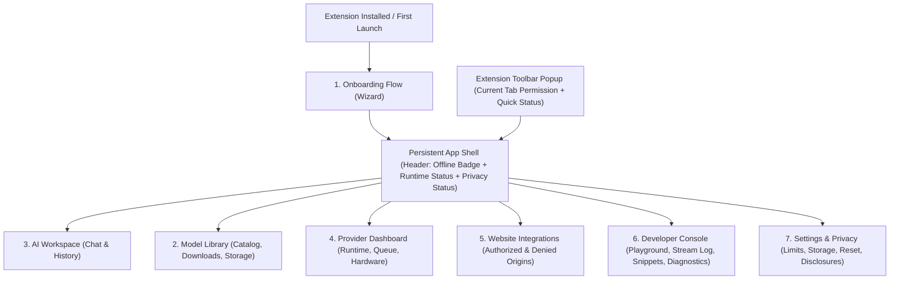

# UOAI — Product UX Requirements

| Field | Value |
|---|---|
| Document | Product UX and Information Architecture Specification |
| Version | 0.1 (Draft for review) |
| Parent | [BRD.md](../business/BRD.md) |
| Related | [FUNCTIONAL_REQUIREMENTS.md](../requirements/FUNCTIONAL_REQUIREMENTS.md), [NON_FUNCTIONAL_REQUIREMENTS.md](../requirements/NON_FUNCTIONAL_REQUIREMENTS.md), [USER_JOURNEYS.md](../requirements/USER_JOURNEYS.md) |

---

## 1. UX Design Principles

1. **Clarity over visual complexity:** Modern, minimal, high-contrast typography and generous whitespace. Avoid cluttered charts or unexplained ML jargon.
2. **Always-visible system truth:** The user must always be able to see three facts at a glance in the persistent shell header:
   - **Offline Readiness:** `Offline Ready` | `Partially Ready` | `Setup Needed` (plus current network indicator `Online` / `Offline`).
   - **Runtime & Active Model Status:** `Idle (No model loaded)` | `Loading <model>…` | `Ready: <model>` | `Generating…` | `Error`.
   - **Privacy Guarantee Badge:** `Local-Only • 0 Prompts Sent to Cloud`.
3. **Actionable empty and error states:** Every empty state and error alert must state *what happened*, *why*, and provide *at least one primary action button*.
4. **Accessibility by default:** WCAG 2.2 Level AA target (NFR-026), full keyboard navigation (NFR-027), throttled polite ARIA live regions for streaming tokens (NFR-028), and `prefers-reduced-motion` / dark-mode support (NFR-029).

---

## 2. Information Architecture

UOAI consists of two surface groups:
1. **Extension Toolbar Popup (Compact Control Surface):** Quick status summary, active current-tab origin permission toggle (**Allow / Revoke this site**), loaded model quick-unload, and **Open UOAI Dashboard** button.
2. **Main Dashboard / PWA (Full Application Shell):** Persistent left navigation sidebar (collapsible on narrow viewports) with 6 primary views, preceded by the guided **Onboarding** flow on first launch.

---

## 3. Screen-by-Screen UX Requirements

### 3.1 Screen 1 — Onboarding

| Dimension | Specification |
|---|---|
| **Purpose** | Guide a first-time user from installation through capability verification, first model download, model load, and first local generation to an `Offline Ready` state (FR-001 – FR-008). |
| **Primary User** | Maya (P1, Non-technical user), Dr. Lena (P3, Privacy professional). |
| **Main Components** | - **Step Progress Stepper:** 1. Welcome → 2. System Check → 3. Download Model → 4. Test Local AI → 5. Offline Ready. - **Welcome Card:** Plain-language value summary & privacy commitment (FR-001). - **Capability Checklist Card:** Browser check, WebGPU adapter/features check, and available disk space check with Pass/Warn/Fail badges (FR-002, FR-003, FR-048). - **Recommended Model Card:** Model name, download size (GB), quantization, license summary + mandatory acceptance checkbox (FR-006, FR-015), and progress bar (bytes, %, speed, ETA, SHA-256 verification status). - **First Prompt Sandbox:** Pre-filled prompt input, streaming response box, and **Offline Readiness Checklist** (App shell cached, Runtime WASM cached, Model verified) (FR-005, FR-008). |
| **User Actions** | Click *Get Started*; *Re-run System Check*; *Accept License & Download*; *Pause / Resume Download*; *Browse Other Models*; *Run Sample Prompt*; *Finish Setup & Open Workspace*. |
| **Loading States** | - System Check: spinner with sub-step labels (*"Checking WebGPU adapter in worker…"*). - Download: live determinate progress bar with MB/GB, speed, ETA, and *"Verifying SHA-256 integrity…"* phase. - Model Load: staged progress bar (*"Allocating WebGPU buffers… Compiling shaders…"*). |
| **Empty States** | Before download starts, shows estimated disk space after install and reassuring note: *"You only need internet for this step."* |
| **Error States** | - **Extension Missing (on hosted PWA):** Step-by-step store installation card with *"Check Again"* button (FR-004). - **WebGPU Unsupported:** Plain-language explanation + expandable troubleshooting steps (`chrome://gpu`, hardware acceleration toggle, driver update) and disabled download CTA (UC-11). - **Insufficient Storage:** Shows required vs. available GB and blocks download (UC-12). - **Integrity Failure:** Explains file corruption and provides *Retry Download* button (UC-13). |
| **Offline States** | If user goes offline before completing model download, displays *Paused — Waiting for internet connection to finish initial download* with automatic resume alert when back online (FR-108). |
| **Accessibility** | Focus moves automatically to the active step heading on step transition; progress updates announced via `aria-live="polite"` at 25%, 50%, 75%, 100%, and state changes. |

---

### 3.2 Screen 2 — Model Library

| Dimension | Specification |
|---|---|
| **Purpose** | Discover qualified models, inspect hardware/license metadata, download and verify artifacts, load/unload models, update versions, and manage storage usage (FR-010 – FR-023). |
| **Primary User** | Maya (P1), Dr. Lena (P3), Sam (P5). |
| **Main Components** | - **Storage Summary Banner:** Used space per model, total UOAI usage, browser quota estimate, persistence badge (`Persisted` / `Not Persisted` + *Request Persistence* action) (FR-023, FR-106). - **Filter & Search Bar:** Tabs for *Installed*, *Compatible*, *All Qualified Models*; search by name/ID. - **Model Cards Grid:** Name, API identifier (`copy` button), publisher, download size, quantization badge (e.g., `q4f16`), context length (max vs. default), compatibility badge (`Compatible`, `Compatible with Limitations`, `Incompatible`), install status (`Not Installed`, `Downloading`, `Verifying`, `Ready`, `Loaded`, `Update Available`). - **Model Details Drawer / Modal:** Full manifest metadata, artifact list with SHA-256 hashes, hardware minimums, tested configurations, full offline-accessible license text, and acceptance modal (FR-011, FR-015). |
| **User Actions** | *Filter/Search*; *View Details & License*; *Accept License & Download*; *Pause / Resume / Cancel Download*; *Load Model*; *Unload Model*; *Update Model*; *Remove Model* (with space-freed confirmation). |
| **Loading States** | Skeleton cards only on initial IndexedDB read (< 200 ms); active downloads show inline determinate progress bars; loading a model shows staged spinner on the card and disables conflicting load buttons (FR-021). |
| **Empty States** | *Installed* tab when 0 models installed: *"No models installed yet. Download a compatible model below to enable offline AI."* |
| **Error States** | - *Incompatible* badge lists exact reason (e.g., *"Requires WebGPU shader-f16"* or *"Requires 4.0 GB maxBufferSize; device supports 2.0 GB"*). - *Failed — Integrity* or *Missing Files (Evicted)* card banner with *Repair / Re-download* action (FR-103). |
| **Offline States** | Renders full catalog from bundled/cached verified registry (FR-010). Installed models can be loaded, unloaded, or removed offline. Uninstalled models replace *Download* with disabled *"Requires internet to download"*. |
| **Accessibility** | Model cards use semantic `<article>` landmarks with accessible names; progress bars include `aria-valuenow`, `aria-valuemin`, `aria-valuemax`, and human-readable `aria-valuetext`. |

---

### 3.3 Screen 3 — AI Workspace

| Dimension | Specification |
|---|---|
| **Purpose** | Private, offline-capable local chat interface for conversing with installed models, managing local conversation history, and switching models (FR-030 – FR-038). |
| **Primary User** | Maya (P1), Dr. Lena (P3). |
| **Main Components** | - **Conversation Sidebar:** *New Chat* button, search input, chronological conversation list with rename/delete actions, and *Ephemeral Mode (Don't save history)* toggle indicator (FR-032, FR-036). - **Workspace Header:** Active Model Selector dropdown (lists `Ready` models with `Loaded` indicator, FR-031), context window usage meter (prompt + completion tokens / limit), and *Clear Conversation* button (FR-035). - **Message Transcript Area:** User and Assistant message bubbles with timestamps, model ID tag, copy-response button, and sanitized Markdown/code-block rendering (FR-030, FR-033). - **Prompt Composer:** Auto-expanding multi-line `<textarea>`, token estimate indicator, **Send** button (`Enter`), and prominent **Stop** button (`Esc` or click during generation, FR-034). |
| **User Actions** | *Create / Select / Rename / Delete Conversation*; *Switch Model*; *Compose & Send Prompt*; *Stop Generation*; *Copy Response*; *Clear Conversation*; *Retry Failed Turn*. |
| **Loading States** | - If selected model is not loaded: inline banner *"Loading <model> from local storage…"* with stage progress before first token. - If request is queued behind another request: *"Queued (position #1)…"*. - During streaming: animated typing indicator + incremental Markdown rendering with auto-scroll lock toggle. |
| **Empty States** | - **No model installed:** Friendly prompt with direct button *Go to Model Library to Download a Model*. - **New conversation:** Starter prompt suggestions (e.g., *"Summarize text below"*, *"Draft an email"*, *"Explain a concept"*) and reminder: *"Runs 100% on your device."* |
| **Error States** | Inline error card inside the conversation stream mapping `UOAIError.code` to plain language (e.g., `context_length_exceeded` → *"This conversation reached the model's 4,096-token memory limit. Clear or start a new conversation."*; `runtime_restarted` → *"The local AI worker restarted. Click Retry to generate again."*) (FR-037). |
| **Offline States** | Fully functional offline (FR-038). Header displays green **Offline — Local AI Active** pill. |
| **Accessibility** | Keyboard shortcuts: `Enter` to send, `Shift+Enter` for newline, `Escape` to stop generation (NFR-027). Streaming output uses a throttled polite ARIA live region (updates at sentence boundaries or every 2 s) and announces *"Response complete"* on finish (NFR-028). |

---

### 3.4 Screen 4 — Provider Dashboard

| Dimension | Specification |
|---|---|
| **Purpose** | Give the user a transparent command center over the local AI provider: runtime lifecycle, loaded model, active request queue, hardware capability summary, and offline readiness breakdown (FR-002, FR-003, FR-047 – FR-051, FR-100). |
| **Primary User** | All users (P1 – P5). |
| **Main Components** | - **Runtime Status Card:** Current state (`not_started`, `idle`, `loading_model`, `ready`, `generating`, `recovering`, `error`), active loaded model, uptime, idle auto-unload countdown timer (BR-20), and **Unload Model / Restart Runtime** buttons (FR-021, FR-047, FR-050). - **Offline Readiness Checklist Card:** Status of App Shell, Runtime WASM/JS, Verified Model Artifacts, and Persistent Storage grant (FR-100 – FR-103). - **Request Queue Monitor:** Active generation indicator (1 max, BR-09) and pending FIFO queue (0–5 items, BR-10) showing requesting origin (`Workspace` or authorized domain) and elapsed time, with **Cancel Request** button. - **Hardware & WebGPU Profile Card:** Browser version, WebGPU adapter vendor/architecture, key buffer limits, `shader-f16` status, and *Re-run Capability Check* button (FR-002, FR-003). |
| **User Actions** | *Load / Unload Active Model*; *Restart Runtime*; *Cancel Active/Queued Request*; *Re-run Capability Check*. |
| **Loading States** | Live status transitions (`starting` → `loading_model` → `ready`) pushed via extension port within 1 s (FR-047). |
| **Empty States** | When runtime is `not_started` or `idle`: *"No model is currently loaded in GPU memory. 0 MB GPU memory in use."* |
| **Error States** | If runtime is in `error` (e.g., after >3 crash retries, FR-049): prominent alert card with last error code, plain-language explanation, and *Reset & Restart Runtime* action. |
| **Offline States** | 100% functional offline; Offline Readiness card confirms all local dependencies pass. |
| **Accessibility** | Status changes announced via `role="status"`; queue table navigable by keyboard with explicit action labels (*"Cancel request from notes.example.com"*). |

---

### 3.5 Screen 5 — Website Integrations

| Dimension | Specification |
|---|---|
| **Purpose** | View, authorize, audit, and immediately revoke external websites' access to the local AI provider (FR-060 – FR-064). |
| **Primary User** | Dr. Lena (P3), Arjun (P2), Ravi (P4), Maya (P1). |
| **Main Components** | - **Add Website Origin Bar:** Manual HTTPS origin input (`https://example.com`, or `http://localhost:PORT` when Developer Mode is enabled) with **Authorize Origin** button (triggers two-layer consent flow, FR-060, FR-061). - **Built-In Trusted Origin Card:** Displays the configured first-party PWA origin with a `Built-in` badge and explanation (BR-18). - **Authorized Websites Table:** Lists each allowed third-party origin, grant date, last-used timestamp, local request count, active connection badge (`Connected` / `Idle`), and one-click **Revoke** button (FR-063, FR-064). - **Denied Websites List:** Lists origins previously denied by the user with an **Allow** or **Remove from List** action (FR-062). - **Two-Layer Consent Sheet (Modal / Popup):** Displays exact scheme + host + port, explicitly lists allowed vs. prohibited capabilities, and triggers the browser's optional host permission prompt on click (FR-061). |
| **User Actions** | *Authorize New Origin*; *Revoke Origin*; *Revoke All Third-Party Websites*; *Un-deny Origin*. |
| **Loading States** | Reconciling grants with `chrome.permissions.getAll()` shows brief inline indicator (< 200 ms). |
| **Empty States** | When no third-party websites are authorized: *"No external websites have access to your local AI. Websites can only connect after you explicitly approve them."* |
| **Error States** | Invalid manual origin input shows inline format guidance (*"Enter a full HTTPS origin such as https://app.example.com without paths or wildcards"*). |
| **Offline States** | 100% functional offline; users can view and revoke permissions or authorize `http://localhost` development origins offline. |
| **Accessibility** | Each **Revoke** button includes the origin in its `aria-label` (e.g., `Revoke access for https://notes.example.com`); modal consent sheet traps focus and supports `Escape` to cancel. |

---

### 3.6 Screen 6 — Developer Console

| Dimension | Specification |
|---|---|
| **Purpose** | Provide developers with a built-in workbench to test SDK connections, inspect `models.list`, run interactive non-streaming and streaming completions, inspect content-free error logs, and export runtime diagnostics (FR-090 – FR-097). |
| **Primary User** | Arjun (P2, Web developer), Sam (P5, Contributor), Ravi (P4, Admin). |
| **Main Components** | - **Connection & Health Tester:** One-click test showing step-by-step latency (Handshake → Protocol Negotiation → `GET /v1/health` → `GET /v1/runtime`) (FR-091). - **Interactive API Playground:** Form & raw JSON editor for `POST /v1/chat/completions` (`model`, `messages`, `temperature`, `top_p`, `max_tokens`, `stop`, `stream`) with live Zod schema validation, **Send Request**, and **Cancel Stream** buttons (FR-093, FR-094). - **Response & Stream Chunk Inspector:** Tabs for *Rendered Output*, *Stream Chunk Log* (sequence #, delta, latency, TTFT, tok/s), and *Raw JSON* (`ChatCompletion` or `models.list` payload) (FR-092, FR-094). - **Code Snippets Tab:** Copyable TypeScript snippets pre-filled with the user's installed model IDs (FR-090). - **Origin Permission Checker:** Input field to verify if an origin is `Allowed`, `Denied`, or `Not Authorized` (FR-096). - **Error & Diagnostics Inspector:** Ring buffer of recent errors and runtime events (strictly content-free, BR-05) plus **Export Diagnostics JSON** button (FR-095, FR-097). |
| **User Actions** | *Run Connection Test*; *Execute Playground Request*; *Cancel Stream*; *Copy Code Snippet*; *Check Origin Status*; *Trigger Sample Error*; *Export Diagnostics JSON*. |
| **Loading States** | Live token/s counter and chunk table updates during streaming test. |
| **Empty States** | Chunk log and error log display clear empty placeholders when no requests or errors have occurred in the session. |
| **Error States** | Schema validation errors highlight the exact offending JSON field/parameter (`param`) before transmission; runtime errors render the exact `UOAIError` JSON structure alongside its explanation. |
| **Offline States** | 100% functional offline against installed local models. |
| **Accessibility** | Monospace code/JSON regions are keyboard-scrollable with copy buttons announcing *"Copied to clipboard"* via `aria-live`. |

---

### 3.7 Screen 7 — Settings and Privacy

| Dimension | Specification |
|---|---|
| **Purpose** | Configure runtime policies, inspect network activity transparency logs, review privacy and license disclosures, and exercise data deletion controls (FR-120 – FR-124). |
| **Primary User** | Dr. Lena (P3), Maya (P1), Ravi (P4). |
| **Main Components** | - **Privacy & Local-Only Guarantee Card:** Plain-language disclosure of data classification, local storage locations (OPFS, Cache Storage, IndexedDB, `chrome.storage.local`), retention policy, and no-telemetry default (FR-122). - **Network Activity Transparency Log:** Live indicator (`Idle` / `Downloading Model` / `Refreshing Registry`) and recent network request log (timestamp, host, purpose, bytes transferred — zero prompt content) (FR-124, BR-21). - **Runtime & Resource Policies:** Configurable idle model auto-unload timeout (default 15 min, or 5 min / 30 min / Never, BR-20); per-request default `max_tokens` cap for websites (default 1,024, BR-14); per-origin rate limit (default 30 req/min, BR-15); website model auto-load toggle (OQ-13). - **Developer Options:** Enable `http://localhost` origin authorization for local development (FR-060); Advanced override to allow downloading models flagged with warnings (FR-012). - **Data & Storage Controls (Danger Zone):**   - *Ephemeral History Toggle* (do not persist future workspace chats, FR-036).   - **Delete All Conversation History** button (FR-120).   - **Reset UOAI (Delete All Models, History, Permissions & Settings)** button with two-step confirmation showing space to be freed (FR-121). - **Open-Source & Model Licenses:** Bundled offline notices for UOAI dependencies and installed model licenses. |
| **User Actions** | *Update Runtime Policies*; *Toggle Ephemeral Mode*; *Toggle Developer Mode*; *Inspect Network Activity Log*; *Delete Conversation History*; *Reset All UOAI Data*. |
| **Loading States** | Deleting history or resetting all data shows a modal progress indicator until storage deletion promises resolve. |
| **Empty States** | Network Activity Log when no downloads/refreshes have run: *"0 network requests recorded in this session."* |
| **Error States** | If an invalid policy number is entered, inline validation prevents saving and explains the allowed bounds; corrupted stored settings notify the user that defaults were restored (FR-123). |
| **Offline States** | 100% functional offline, including viewing bundled OSS and model licenses and executing data deletions. |
| **Accessibility** | Destructive actions (*Delete All History*, *Reset UOAI*) use accessible confirmation dialogs (`role="alertdialog"`) with explicit focus management and clear button labels. |
