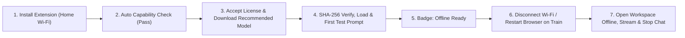

# UOAI — User Journeys

| Field | Value |
|---|---|
| Document | End-to-End User Journeys |
| Version | 0.1 (Draft for review) |
| Parent | [BRD.md](../business/BRD.md) |
| Related | [STAKEHOLDERS_AND_PERSONAS.md](../business/STAKEHOLDERS_AND_PERSONAS.md), [USE_CASES.md](USE_CASES.md), [UX_REQUIREMENTS.md](../product/UX_REQUIREMENTS.md) |

---

## 1. Overview

While [USE_CASES.md](USE_CASES.md) specifies individual system interactions (UC-01 – UC-15), this document maps the **8 end-to-end persona journeys (UJ-01 – UJ-08)** across multiple sessions, network conditions, and screens. Together, UJ-01 through UJ-08 cover all 15 required journey scenarios from the BRD.

### 1.1 Scenario-to-Journey Mapping

| # | Required Journey Scenario | Covered in Journey | Detailed Use Case |
|---|---|---|---|
| 1 | First-time installation | UJ-01 | UC-01 |
| 2 | Downloading the first AI model | UJ-01 | UC-02 |
| 3 | Running a chat without internet access | UJ-01 | UC-03 |
| 4 | Reopening UOAI after browser restart | UJ-01 | UC-04 |
| 5 | Connecting a third-party website | UJ-02 | UC-05 |
| 6 | Approving a website's AI access request | UJ-02, UJ-03 | UC-06 |
| 7 | Making an inference request from an external website | UJ-02 | UC-07 |
| 8 | Receiving a streaming response | UJ-02 | UC-08 |
| 9 | Cancelling a generation | UJ-01, UJ-02 | UC-09 |
| 10 | Revoking a website's permission | UJ-03 | UC-10 |
| 11 | Handling unsupported WebGPU | UJ-05 | UC-11 |
| 12 | Handling insufficient device resources | UJ-05 | UC-12 |
| 13 | Handling corrupted or incomplete model downloads | UJ-06 | UC-13 |
| 14 | Recovering from runtime failure | UJ-06 | UC-14 |
| 15 | Switching models | UJ-04 | UC-15 |

---

## UJ-01 — Maya (P1, Non-Technical User): Zero to Offline Daily AI Assistant

**Persona:** Maya (P1, teacher, Windows laptop with Chrome).
**Goal:** Set up UOAI once at home on Wi-Fi, then draft lesson plans on a commuter train with no internet connection, including after restarting her laptop.
**Use Cases Traversed:** UC-01 → UC-02 → UC-03 → UC-09 → UC-04.

### Step-by-Step Journey

| Phase | User Action | System Response | Emotional State & UX Focus |
|---|---|---|---|
| **1. Install** (UC-01) | Installs UOAI extension from Chrome Web Store. | Opens Welcome tab automatically; explains in plain language: *"Download once, use offline forever. Your prompts stay on your laptop."* | Reassured — no account sign-up or credit card asked. |
| **2. Capability Check** (UC-01) | Clicks **Get Started**. | Runs browser, WebGPU, and storage checks in < 5 s; shows green checkmarks and recommends one compatible model (`gemma-4-e2b`). | Relieved — no technical jargon or terminal commands. |
| **3. First Download** (UC-02) | Reviews license summary, checks **I accept**, clicks **Download**. | Requests persistent storage; shows progress bar (MB/GB, %, speed, ETA); verifies SHA-256 hashes upon completion. | Patient — clear progress and ETA prevent anxiety during multi-GB download. |
| **4. First Inference** (UC-01/02) | Clicks **Try Sample Prompt** ("Give me 3 interactive quiz ideas on photosynthesis"). | Loads model with staged progress ("Loading weights… Compiling GPU shaders…"); streams response locally; displays **Offline Ready** badge. | Delighted — immediate proof that AI runs on her machine. |
| **5. Offline & Restart** (UC-04) | Next morning on the train (no Wi-Fi), powers on laptop, opens Chrome, clicks UOAI icon. | Dashboard opens in < 3 s from local assets; shows `Offline — Local AI Active` and yesterday's conversation in the sidebar. | Confident — works without internet just like a native app. |
| **6. Offline Chat & Stop** (UC-03, UC-09) | Starts a new chat; asks for a long worksheet, then realizes she forgot to specify grade level and clicks **Stop**. | Streams response offline; on **Stop**, halts generation within 500 ms, labels partial message *Stopped*, and lets her send the revised prompt. | In control — responsive and private. |

---

## UJ-02 — Arjun (P2, Web Developer): Integrating Local AI into a Web App via `@uoai/sdk`

**Persona:** Arjun (P2, front-end developer building an HTTPS note-taking web app).
**Goal:** Add a "Summarize Note (On-Device AI)" button to his React/TypeScript web app using `@uoai/sdk`, test streaming and cancellation, and verify behaviour in the Developer Console.
**Use Cases Traversed:** UC-05 → UC-06 → UC-07 → UC-08 → UC-09.

### Step-by-Step Journey

| Phase | Developer / User Action | System Response | Outcome |
|---|---|---|---|
| **1. Explore Console** | Opens UOAI Dashboard → **Developer Console** (FR-090 – FR-094). | Copies pre-filled TypeScript snippet showing `UOAI.connect()` and `ai.chat.completions.create({ stream: true })` with his installed model ID; runs a test request in the Playground. | Understands logical API shape and confirms runtime health in 2 minutes. |
| **2. Install SDK** | Runs `npm install @uoai/sdk` in his web app project (FR-070). | TypeScript compiler auto-completes OpenAI-compatible request/response types (`ChatCompletion`, `ChatCompletionChunk`, `UOAIError`) (FR-080). | Familiar developer experience; zero API keys or backend proxy code required. |
| **3. First Connection Attempt** (UC-05) | Loads his app at `https://notes.example.com` (or `http://localhost:5173` with Developer Mode on) and clicks "Enable Local AI". | `UOAI.connect()` returns `UOAIError(code: "permission_required")`. App displays a clean banner: *"Click the UOAI extension icon in your toolbar and choose Allow."* | Graceful handling of unauthorized origin; no ugly console crashes. |
| **4. Grant Permission** (UC-06) | Clicks UOAI toolbar icon → **Allow this site to use UOAI** → confirms UOAI consent sheet and browser permission prompt. | Extension saves grant, registers & injects Content-Script Bridge, and emits `permission_granted`. | Explicit two-layer user consent completed in 3 clicks. |
| **5. List Models & Stream** (UC-07, UC-08) | App calls `ai.models.list()` then `ai.chat.completions.create({ model, messages, stream: true, signal })`. | `models.list()` returns installed `Ready` models; streaming completion yields token chunks in real time into the note summary panel. | Fast, zero-cost streaming summarization running on the user's GPU. |
| **6. Cancel Stream** (UC-09) | User clicks "Cancel Summary" in Arjun's app, calling `abortController.abort()`. | SDK sends cancel signal through bridge; Worker stops generation within 500 ms; iterator exits with `generation_cancelled`. | Clean resource release and responsive UI. |

---

## UJ-03 — Dr. Lena (P3, Privacy-Conscious Professional): Auditing Privacy, Permissions, and Data Deletion

**Persona:** Dr. Lena (P3, clinical psychologist on macOS Apple Silicon).
**Goal:** Verify that no prompt data leaves her MacBook, strictly control and revoke third-party website access, and erase conversation history after drafting sensitive summaries.
**Use Cases Traversed:** UC-03 → UC-06 → UC-10.

### Step-by-Step Journey

1. **Privacy & Network Audit Before Use:** Dr. Lena opens **Settings & Privacy** (FR-122, FR-124). She reviews the data storage disclosure (all data in local browser storage; telemetry off by default) and checks the **Network Activity Log**, confirming that network traffic only occurred during model download and is completely idle during chat.
2. **Offline Sensitive Session (UC-03):** She disables Wi-Fi (or enables **Ephemeral / No-History Mode**, FR-036) and uses the AI Workspace to rephrase anonymized session notes. The Network Activity indicator remains at `0 requests`.
3. **Temporary Website Authorization (UC-06):** Later, she authorizes a web-based research tool (`https://research-tool.example.org`) to summarize a public article using her local model.
4. **Immediate Permission Revocation (UC-10):** When finished with the research tool, she opens **Website Integrations** (FR-063), sees `https://research-tool.example.org` with its timestamp and request count (`3 requests`), and clicks **Revoke** (FR-064). The extension immediately disconnects the site's port, unregisters its content script, and removes the browser host permission. When the open tab tries another request, it is rejected with `permission_revoked`.
5. **History Deletion (FR-120):** She goes to **Settings & Privacy → Data Controls** and clicks **Delete All Conversation History**. All conversation records in IndexedDB are permanently erased.

---

## UJ-04 — Model Comparison and Switching Journey

**Persona:** Maya (P1) or Arjun (P2).
**Goal:** Install a second qualified model from the Model Library, switch between installed models offline, and remove an unneeded model to reclaim disk space.
**Use Cases Traversed:** UC-02 → UC-15.

1. **Discover & Install Second Model (UC-02):** While online, the user opens **Model Library** (FR-010), compares context length, quantization, and memory requirements of a second qualified model (FR-011 – FR-014), accepts its license (FR-015), downloads it, and passes SHA-256 verification (FR-018).
2. **Switch Active Model Offline (UC-15):** While offline in the **AI Workspace**, the user changes the conversation's model selector from Model A to Model B (FR-031). The runtime cleanly unloads Model A (freeing WebGPU buffers, FR-050), loads Model B from local storage with staged progress (FR-041), and generates the next response with Model B.
3. **Reclaim Storage (FR-020):** Seeing in **Storage Usage** (FR-023) that two models consume 4.2 GB, the user clicks **Remove** on Model A. The system confirms the space to be freed, deletes Model A's artifacts from OPFS/Cache Storage, and updates storage metrics immediately.

---

## UJ-05 — Unsupported Hardware and Resource-Constrained Journey

**Persona:** Maya's colleague on an older 8 GB integrated-GPU laptop (RC-4) or a browser with WebGPU disabled.
**Goal:** Understand why a model cannot run without wasting bandwidth or experiencing mysterious crashes.
**Use Cases Traversed:** UC-11, UC-12.

1. **Scenario A — WebGPU Disabled / Unsupported (UC-11):** During Onboarding (FR-003), capability detection finds no WebGPU adapter. Instead of crashing or silently sending prompts to the cloud (BR-02), UOAI displays a clear diagnostic screen: *"WebGPU is not enabled on your browser/GPU"*, explains how to check `chrome://gpu` and hardware acceleration settings, and disables downloads of WebGPU models (BR-13).
2. **Scenario B — Low Disk Space or Insufficient GPU Memory (UC-12):** On a laptop with WebGPU enabled but only 1.2 GB of free disk space, the user clicks **Download** on a 1.8 GB model. UOAI blocks the download upfront (`insufficient_storage`, FR-048), showing *"Required: 2.0 GB (including safety margin) • Available: 1.2 GB"*. If a device has disk space but hits a WebGPU out-of-memory error during load, UOAI catches the error cleanly, releases partial memory, and advises closing heavy tabs or choosing a smaller quantized model.

---

## UJ-06 — Resilience Journey: Interrupted Download, Corrupted Artifact, and Runtime Crash Recovery

**Persona:** Any user on an unstable network or under heavy system GPU load.
**Goal:** Recover gracefully from network drops, corrupted files, and runtime crashes without losing working state.
**Use Cases Traversed:** UC-13, UC-14.

1. **Network Drop & Resume During Download (UC-13 / FR-108):** At 62% of a 1.6 GB model download, the user closes their laptop lid. When they reopen the browser later on Wi-Fi, the Model Library shows the model as **Paused / Interrupted (62%)** with a **Resume** button. Clicking **Resume** continues from the last persisted byte offset via HTTP Range (FR-017).
2. **Corrupted Artifact Rejection (UC-13 / FR-018):** If an artifact is corrupted in transit, the streaming SHA-256 verifier detects the mismatch, purges the bad staging file, keeps the model out of `Ready` state (BR-08), and offers a one-click **Retry Download**.
3. **Mid-Generation Worker Crash / WebGPU Device Loss (UC-14 / FR-049):** While generating a response, another application triggers a GPU reset (`device.lost`). UOAI terminates the in-flight request with a clear retryable notice (`runtime_restarted`), automatically recreates the dedicated Inference Worker in the background, reloads the verified model from local storage, and succeeds when the user clicks **Retry**.

---

## UJ-07 — Ravi (P4, Enterprise Administrator): Evaluating Governance and Security Boundaries

**Persona:** Ravi (P4, IT Administrator evaluating UOAI for internal pilot).
**Goal:** Validate that UOAI enforces strict origin isolation, requires no cloud credentials, and cannot be abused by untrusted websites.
**Use Cases Traversed:** UC-05, UC-06, UC-10, UC-11.

1. **Zero-Egress Verification:** Ravi inspects network traffic via proxy/packet capture while running prompts in the AI Workspace and via the Developer Console test harness, confirming zero prompt egress (BO-01).
2. **Origin Isolation Test:** Ravi authorizes internal app `https://app1.internal.example:8443` and confirms that `https://app2.internal.example:8443` and `http://app1.internal.example:8443` are rejected (`origin_not_allowed`, BR-04).
3. **Diagnostic Export Review:** He clicks **Export Diagnostics** in the Developer Console (FR-097) and verifies the exported JSON contains hardware limits, status events, and error codes, but zero user prompts or model outputs (BR-05).
4. **Future Scope Note:** Ravi notes that centralized `chrome.storage.managed` GPO/MDM policy enforcement for pre-approving origins/models is documented as a post-MVP enhancement (X-11).

---

## UJ-08 — Sam (P5, Open-Source Contributor): Qualifying and Adding a New Browser-Compatible Model

**Persona:** Sam (P5, ML engineer and open-source contributor).
**Goal:** Qualify a new quantized instruction model and submit a pull request to `packages/model-registry` and `packages/model-adapters`.
**Related Specification:** [MODEL_COMPATIBILITY_REQUIREMENTS.md](../architecture/MODEL_COMPATIBILITY_REQUIREMENTS.md).

1. **Review Qualification Checklist:** Sam reads `MODEL_COMPATIBILITY_REQUIREMENTS.md` and verifies the candidate model has ONNX / Transformers.js WebGPU-compatible operators, a supported tokenizer, a deterministic chat template, and permissive redistribution/use license terms.
2. **Prepare Manifest & Hashes:** Sam generates SHA-256 hashes and exact byte sizes for every artifact file, defines minimum WebGPU limits (`maxBufferSize`, `maxStorageBufferBindingSize`, required features), and documents license metadata and attribution.
3. **Run Conformance & Golden Tests:** Sam runs the model adapter test suite (tokenizer parity, chat template golden files, load/unload memory leak test, benchmark protocol across reference configurations).
4. **Submit PR:** Sam submits the registry manifest entry and benchmark results for review by the Architecture Lead and Legal/Product Owner (BO-08).
