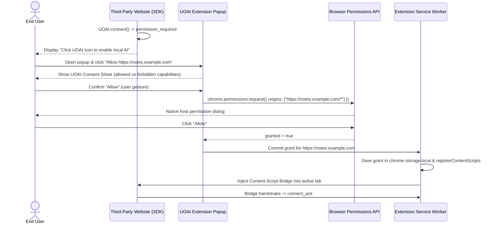
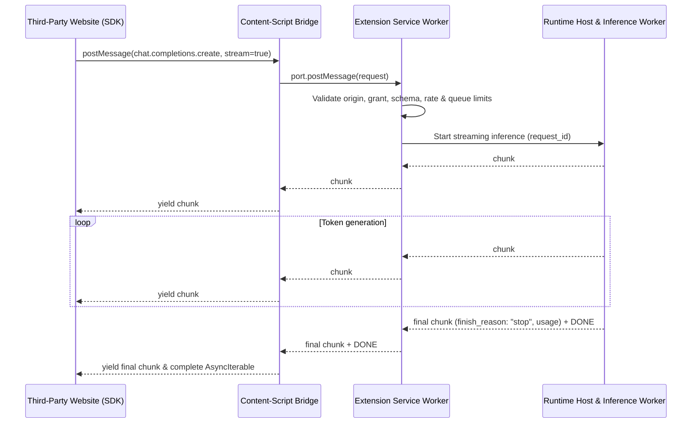
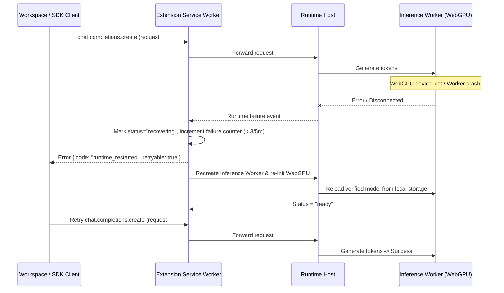

# UOAI — Use Cases Specification

| Field | Value |
|---|---|
| Document | Use Cases Specification |
| Version | 0.1 (Draft for review) |
| Parent | [BRD.md](../business/BRD.md) |
| Related | [USER_JOURNEYS.md](USER_JOURNEYS.md), [FUNCTIONAL_REQUIREMENTS.md](FUNCTIONAL_REQUIREMENTS.md), [ACCEPTANCE_CRITERIA.md](ACCEPTANCE_CRITERIA.md) |

---

## 1. Overview

This document specifies the 15 foundational use cases (UC-01 – UC-15) required for Universal Offline AI (UOAI). Each use case defines actors, preconditions, triggers, main flows, alternative flows, exception flows, postconditions, and testable acceptance criteria, accompanied by Mermaid sequence diagrams for key multi-component interactions.

### 1.1 Actors

| Actor | Description |
|---|---|
| **End User** | Individual using the UOAI browser extension and Dashboard/PWA (Personas P1, P3). |
| **Developer / Third-Party Website** | External web application loaded in a browser tab using `@uoai/sdk` (Persona P2). |
| **UOAI Dashboard / PWA** | First-party user interface (Onboarding, Model Library, Workspace, Integrations, Console, Settings). |
| **Extension Service Worker (SW)** | Manifest V3 background coordinator handling routing, permission checks, queue, and lifecycle. |
| **Content-Script Bridge** | Isolated-world content script injected into user-authorized third-party origins. |
| **Runtime Host & Inference Worker** | Extension-owned execution context (offscreen document / extension page) running a dedicated Web Worker with WebGPU access. |
| **Local Storage** | Extension-origin storage (OPFS / Cache Storage for model weights; IndexedDB for metadata/history; `chrome.storage.local` for settings/grants). |

---

## UC-01 — First-Time Installation and Onboarding

| Field | Detail |
|---|---|
| **Use Case ID** | UC-01 |
| **Actor** | End User, Extension Service Worker, UOAI Dashboard, Runtime Host |
| **Preconditions** | User is running a Chromium-based browser; UOAI extension is not yet installed. |
| **Trigger** | User installs the UOAI browser extension from the browser store (or opens the Dashboard for the first time). |
| **Main Flow** | 1. Browser completes extension installation and fires `chrome.runtime.onInstalled`.<br>2. SW initializes default settings in `chrome.storage.local` (`onboardingComplete = false`) and opens the UOAI Dashboard to the Welcome screen (FR-001).<br>3. Welcome screen explains local-only inference, one-time internet requirement for setup/download, and privacy guarantees.<br>4. User clicks **Get Started**.<br>5. Dashboard triggers browser compatibility checks (FR-002) and requests the SW/Runtime Host to run WebGPU capability detection in a dedicated Worker context (FR-003).<br>6. System records WebGPU adapter limits (`maxBufferSize`, `maxStorageBufferBindingSize`) and features (`shader-f16`) and evaluates free storage via `navigator.storage.estimate()` (FR-048).<br>7. Dashboard displays a **Compatible** summary and recommends a qualified model from the bundled registry (FR-006).<br>8. User proceeds to download and verify the first model (see UC-02), loads the model, runs a sample prompt (FR-008), and passes the Offline Readiness Check (FR-005).<br>9. System marks `onboardingComplete = true`. |
| **Alternative Flows** | **A1 — User starts from hosted PWA before installing extension:** Hosted PWA fails `chrome.runtime.connect` handshake within 2 s, displays "Extension Required" screen with store installation link (FR-004), and polls/re-checks when the user clicks "I've installed it".<br>**A2 — Compatible with limitations:** Device lacks `shader-f16` or has limited buffer sizes; system displays a warning badge and recommends a smaller quantization or lower default context window (FR-012). |
| **Exception Flows** | **E1 — Unsupported browser or missing WebGPU:** Capability check fails; flow branches to UC-11. Download buttons for incompatible models are disabled (BR-13).<br>**E2 — Insufficient disk space:** Storage check detects free space below model size + 10% safety margin; flow branches to UC-12. |
| **Postconditions** | Extension is installed; capability profile is saved in local storage; user is either ready to download a compatible model or clearly informed of hardware/browser limitations. |
| **Acceptance Criteria** | 1. Fresh install opens the Welcome screen within 3 s (TC-001).<br>2. Capability checks execute in the worker context and persist timestamped results (TC-002).<br>3. `onboardingComplete` is set to `true` only after at least one verified model is loaded and generates a response (FR-008). |

---

## UC-02 — Downloading and Verifying the First AI Model

| Field | Detail |
|---|---|
| **Use Case ID** | UC-02 |
| **Actor** | End User, UOAI Dashboard, Extension Service Worker / Download Manager, Local Storage |
| **Preconditions** | Browser and WebGPU compatibility checks passed (UC-01); device has internet access and sufficient disk space. |
| **Trigger** | User selects **Download Model** on a compatible model during Onboarding (FR-006) or in the Model Library (FR-010). |
| **Main Flow** | 1. Dashboard displays model size, quantization, hardware requirements, and license summary (FR-011, FR-013, FR-015).<br>2. If the model license requires acceptance, user reviews and accepts the license terms; system records acceptance timestamp and license version locally (FR-015, BR-19).<br>3. System requests persistent storage via `navigator.storage.persist()` (FR-106).<br>4. Download Manager fetches model artifacts (weights, tokenizer, config, chat template) into a temporary staging area in OPFS/Cache Storage, emitting progress updates (bytes, %, rate, ETA) at ≥ 1 Hz (FR-016).<br>5. As each file completes, the system computes its streaming SHA-256 hash and compares it against the verified registry manifest (FR-018, BR-08).<br>6. Once all files pass SHA-256 and size checks, the system atomically moves artifacts to permanent storage and writes the model record in IndexedDB with status `Ready` (FR-019).<br>7. Offline Readiness status updates to `Offline Ready` (FR-100).<br>8. If triggered from Onboarding, system automatically initiates initial model load (FR-007) and sample prompt execution (FR-008). |
| **Alternative Flows** | **A1 — User pauses and resumes download:** User clicks **Pause**; network stream aborts within 2 s and byte offset is saved. When user clicks **Resume**, download resumes via HTTP `Range` header if supported by host, or restarts current file while preserving completed files (FR-017). |
| **Exception Flows** | **E1 — Network disconnection mid-download:** Download transitions to `Paused / Interrupted` state (FR-108); partial artifacts remain in staging and are never exposed as `Ready`.<br>**E2 — SHA-256 hash mismatch:** System aborts installation, deletes corrupted file from staging, sets status to `Failed — Integrity Check`, and flows to UC-13. |
| **Postconditions** | All model artifacts and dependencies are stored and verified in local storage; model status is `Ready`; Offline Readiness check passes. |
| **Acceptance Criteria** | 1. License acceptance is enforced before any network fetch for acceptance-required models (TC-006).<br>2. All downloaded artifacts match manifest SHA-256 hashes before status becomes `Ready` (TC-007).<br>3. Temporary staging files are cleaned up within 1 minute of install completion (NFR-040). |

```mermaid
sequenceDiagram
  actor User as End User
  participant UI as UOAI Dashboard
  participant DM as Extension Download Manager
  participant CDN as Model Artifact Host
  participant ST as Local Storage (OPFS + IndexedDB)

  User->>UI: Click "Download" & Accept License
  UI->>ST: Record license acceptance & request storage.persist()
  UI->>DM: Start download(modelId)
  loop For each artifact in manifest
    DM->>CDN: HTTPS GET (with Range support)
    CDN-->>DM: Stream chunks
    DM->>ST: Write to staging & compute streaming SHA-256
    DM-->>UI: Progress (bytes, %, speed, ETA)
  end
  DM->>DM: Verify SHA-256 & byte length against manifest
  alt All hashes match
    DM->>ST: Atomic move staging -> final; write IndexedDB status="Ready"
    DM-->>UI: Status = Ready (Offline Ready)
  else Hash mismatch
    DM->>ST: Purge corrupted staging artifact
    DM-->>UI: Error: model_integrity_failed
  end
```

---

## UC-03 — Running a Chat Without Internet Access

| Field | Detail |
|---|---|
| **Use Case ID** | UC-03 |
| **Actor** | End User, UOAI Dashboard (AI Workspace), Extension Service Worker, Runtime Host & Inference Worker |
| **Preconditions** | At least one model is installed (`Ready`); Offline Readiness status is `Offline Ready`; device has **no internet connection** (Wi-Fi/Ethernet disabled or Airplane Mode). |
| **Trigger** | User enters a prompt in the Local AI Workspace and clicks **Send** (or presses Enter). |
| **Main Flow** | 1. Workspace detects `navigator.onLine === false` and displays the **Offline — Local AI Active** badge (FR-038, FR-100).<br>2. User submits prompt in an active or new conversation (FR-030).<br>3. Workspace persists the user message locally in IndexedDB (FR-036) and sends a chat completion request to the SW.<br>4. If the selected model is not currently loaded, SW ensures the Runtime Host is running and instructs the Inference Worker to load the model strictly from local storage (FR-041, FR-102).<br>5. Inference Worker applies the model's chat template (FR-043), tokenizes input locally (FR-042), and executes WebGPU token generation (FR-044) with zero network calls (FR-105).<br>6. Inference Worker streams token deltas via the Runtime Host and SW to the Workspace (FR-045).<br>7. Workspace renders sanitized Markdown tokens incrementally (FR-033).<br>8. On EOS or `max_tokens`, worker emits terminal completion chunk with `finish_reason` and `usage`; Workspace saves the assistant response to IndexedDB (FR-036). |
| **Alternative Flows** | **A1 — Model already loaded (warm):** Step 4 is skipped; generation begins immediately.<br>**A2 — Ephemeral mode enabled:** If user enabled ephemeral/no-history mode in Settings, steps 3 and 8 do not write messages to IndexedDB (FR-036). |
| **Exception Flows** | **E1 — Evicted model artifacts:** If browser evicted storage since last session, Step 4 detects missing files (FR-103), updates Offline Readiness to `Not Ready`, and informs user that internet access is needed to re-download.<br>**E2 — Runtime crash during generation:** Handled via UC-14. |
| **Postconditions** | User receives a complete local response offline; conversation history is updated in local IndexedDB; zero network packets are transmitted. |
| **Acceptance Criteria** | 1. Generation succeeds with OS network interface disabled (TC-018).<br>2. Packet capture / network interception confirms 0 outbound requests during model load and generation (TC-033). |

---

## UC-04 — Reopening UOAI After Browser Restart (Offline)

| Field | Detail |
|---|---|
| **Use Case ID** | UC-04 |
| **Actor** | End User, Browser, UOAI Dashboard / PWA, Extension Service Worker, Local Storage |
| **Preconditions** | User completed setup and installed at least one model in a prior session; user quit and restarted the browser while offline. |
| **Trigger** | User opens the UOAI Dashboard (from extension toolbar icon or installed PWA shortcut). |
| **Main Flow** | 1. Browser launches the extension page or loads the PWA from the PWA Service Worker precache (FR-101, FR-104).<br>2. SW wakes up, loads settings and permission grants from `chrome.storage.local` (FR-123), and reconciles grants against `chrome.permissions.getAll()` (FR-063).<br>3. Dashboard reads installed model metadata and conversation history from IndexedDB (FR-036) and runs a fast non-blocking file existence/size check on installed models (FR-102, FR-103).<br>4. Dashboard skips online registry refresh because the browser is offline (FR-104).<br>5. Dashboard becomes interactive within 3 s (NFR-006), displaying previous conversations, installed models (`Ready`, not yet loaded in VRAM), and `Offline Ready` status.<br>6. User selects a previous conversation and sends a follow-up message, triggering lazy model loading from local storage and local generation (UC-03). |
| **Alternative Flows** | **A1 — Browser restarted while online:** Step 4 performs a non-blocking background registry refresh without delaying UI interactivity. |
| **Exception Flows** | **E1 — Corrupted settings in storage:** Schema validation on `chrome.storage.local` fails; system resets invalid keys to safe defaults and logs a diagnostic warning without crashing (FR-123). |
| **Postconditions** | Dashboard is interactive offline within 3 s; previous conversation history and installed models are intact and ready for inference. |
| **Acceptance Criteria** | 1. Cold launch after browser restart with network disabled reaches interactive state in ≤ 3 s on RC-1 – RC-3 (TC-017).<br>2. Prior conversations and installed models are listed accurately (TC-039). |

---

## UC-05 — Connecting a Third-Party Website

| Field | Detail |
|---|---|
| **Use Case ID** | UC-05 |
| **Actor** | Developer / Third-Party Website, End User, Content-Script Bridge, Extension Service Worker |
| **Preconditions** | UOAI extension is installed; third-party website (`https://notes.example.com`) integrates `@uoai/sdk` and is opened by the End User over HTTPS. |
| **Trigger** | Website calls `await UOAI.connect()` (or `await UOAI.isAvailable()`). |
| **Main Flow** | 1. Website invokes `UOAI.connect({ timeoutMs: 3000 })` (FR-071).<br>2. SDK posts a bridge handshake message via `window.postMessage` targeting `window.location.origin`.<br>3. **If origin is already authorized:** The injected Content-Script Bridge relays the handshake over a `chrome.runtime.Port` to the SW (FR-067).<br>4. SW verifies `sender.id` (extension ID), validates the tab/frame origin from browser-provided sender metadata (FR-065), checks the active grant in `chrome.storage.local` (FR-111), and negotiates protocol version (NFR-038).<br>5. SW returns `connect_ack` with protocol version and capability summary.<br>6. `UOAI.connect()` resolves with an authenticated `UOAIClient` instance. |
| **Alternative Flows** | **A1 — Origin is not yet authorized:** No content script is injected on the page. Handshake times out or returns `permission_required`. Website catches `UOAIError(code: "permission_required")` and displays instructions to authorize the site via the UOAI extension popup (leading to UC-06).<br>**A2 — Trusted first-party PWA origin:** Connects directly via `chrome.runtime.connect(extensionId)` using `externally_connectable` without a content-script bridge (FR-065, BR-18). |
| **Exception Flows** | **E1 — Extension not installed or disabled:** Handshake receives no response within `timeoutMs`; SDK rejects with `UOAIError(code: "extension_not_detected")` (FR-068, FR-071).<br>**E2 — Protocol version mismatch:** SDK requires a major protocol version unsupported by the extension; SW returns `protocol_version_unsupported` with supported versions (FR-071). |
| **Postconditions** | Authorized website holds an active, version-negotiated SDK client connection to the SW; unauthorized websites receive a clear error code without waking the inference runtime. |
| **Acceptance Criteria** | 1. Authorized origin connects in ≤ 1 s on RC-1 (TC-021).<br>2. Missing extension rejects with `extension_not_detected` within `timeoutMs` + 100 ms (TC-045).<br>3. Unauthorized origin never wakes the Runtime Host or receives model lists (TC-027). |

---

## UC-06 — Approving a Website's AI Access Request

| Field | Detail |
|---|---|
| **Use Case ID** | UC-06 |
| **Actor** | End User, Third-Party Website, Extension Popup / Dashboard, Extension Service Worker, Browser Permission Manager |
| **Preconditions** | User is visiting an HTTPS third-party website (`https://notes.example.com`) that is not yet authorized. |
| **Trigger** | User clicks the UOAI browser extension toolbar icon while on `https://notes.example.com` and clicks **Allow this site to use UOAI** (FR-060). |
| **Main Flow** | 1. Extension popup identifies the active tab's exact origin (`https://notes.example.com`) and displays UOAI's consent sheet (FR-061).<br>2. Consent sheet clearly states what the site **can** do (list installed models, send prompts to local models, receive responses) and **cannot** do (read user's workspace chats, access local files, install models, or bypass rate limits) (BR-07, BR-23, BR-24).<br>3. User clicks **Allow** in the UOAI consent sheet (providing a user gesture in an extension context).<br>4. Extension invokes `chrome.permissions.request({ origins: ["https://notes.example.com/*"] })` (FR-061).<br>5. Browser displays its native host permission prompt; user approves.<br>6. SW records the grant (`origin`, `grantedAt`, `status: "allowed"`) in `chrome.storage.local` (FR-062, FR-063).<br>7. SW registers the Content-Script Bridge for `https://notes.example.com/*` via `chrome.scripting.registerContentScripts` and injects the bridge into the active tab via `chrome.scripting.executeScript` (FR-062, FR-067).<br>8. Bridge emits a `uoai:permission_granted` event to the page; the website's `UOAI.connect()` call succeeds without requiring a browser restart. |
| **Alternative Flows** | **A1 — Manual origin authorization:** User adds `https://notes.example.com` manually in Dashboard → Website Integrations (FR-060) and completes steps 2–7.<br>**A2 — User denies access:** User clicks **Deny** on the UOAI consent sheet; SW records `status: "denied"` for that origin (FR-062). |
| **Exception Flows** | **E1 — User cancels browser permission prompt:** `chrome.permissions.request` resolves `false`; SW does **not** record an active grant and registers no content script (two-layer consent enforcement, ADR-005).<br>**E2 — Non-HTTPS origin:** If the site is `http://` (and not `http://localhost` with Developer Mode enabled), popup disables authorization and explains that HTTPS is required (FR-060). |
| **Postconditions** | Both browser host permission and UOAI grant are active for the exact origin; Content-Script Bridge is registered and active; origin appears in Authorized Websites list (FR-063). |
| **Acceptance Criteria** | 1. Grant is active if and only if both UOAI approval and browser host permission succeed (TC-021, TC-027).<br>2. A website cannot programmatically open the permission prompt without user interaction in the extension UI (FR-062). |



---

## UC-07 — Making an Inference Request from an External Website (Non-Streaming)

| Field | Detail |
|---|---|
| **Use Case ID** | UC-07 |
| **Actor** | Third-Party Website (SDK), Content-Script Bridge, Extension Service Worker, Runtime Host & Inference Worker |
| **Preconditions** | Origin `https://notes.example.com` holds an active grant (UC-06); SDK is connected (UC-05); requested model `gemma-4-e2b` is installed (`Ready`). |
| **Trigger** | Website calls `await ai.chat.completions.create({ model: "gemma-4-e2b", messages: [...], stream: false })` (FR-074). |
| **Main Flow** | 1. SDK validates request locally and sends a `chat.completions.create` envelope over `window.postMessage` to the Content-Script Bridge (FR-067).<br>2. Bridge forwards the message over its `chrome.runtime.Port` to the SW.<br>3. SW verifies sender origin from browser port metadata (FR-065, FR-115), confirms active grant (FR-112), enforces per-origin rate limit (30 req/min, BR-15) and queue limits (max 2 per-origin, max 5 global, BR-10), and validates payload schema and size (≤ 256 KB, FR-066, BR-16).<br>4. SW assigns an unguessable `request_id` bound to the requesting port (FR-118) and enqueues the request (FR-051).<br>5. When the request reaches the head of the queue (single active generation, BR-09), SW ensures the Runtime Host is alive and `gemma-4-e2b` is loaded in the Inference Worker.<br>6. Inference Worker formats the prompt (FR-043), verifies prompt tokens + `max_tokens` ≤ context length, generates tokens via WebGPU (FR-044), and returns the completed text and token `usage`.<br>7. SW updates the origin's `lastUsedAt` and local request count (FR-063) and sends the `chat.completion` response to the originating port.<br>8. Bridge delivers the response to the page's origin (`targetOrigin = "https://notes.example.com"`); SDK resolves the promise. |
| **Alternative Flows** | **A1 — Request queued behind active generation:** Request waits in FIFO order (up to 5 pending); SW notifies client of queue state.<br>**A2 — Model not currently loaded:** If website auto-load policy is enabled (OQ-13), SW loads the requested installed model; otherwise returns `model_not_loaded`. |
| **Exception Flows** | **E1 — Rate limit or queue full:** SW immediately rejects with `rate_limited` (including `retry_after_ms`) or `queue_full` (FR-051, FR-117).<br>**E2 — Context length exceeded:** Worker detects prompt + `max_tokens` > model context and returns `context_length_exceeded` (FR-043).<br>**E3 — Requested model not installed:** SW returns `model_not_found` without triggering any download (BR-24). |
| **Postconditions** | Website receives an OpenAI-compatible `ChatCompletion` object; no workspace history is modified or exposed (BR-23). |
| **Acceptance Criteria** | 1. Response conforms to `ChatCompletion` schema with non-empty `choices[0].message.content` and accurate `usage` counts (TC-022).<br>2. Request never reads or writes user's Workspace conversation history (TC-029). |

---

## UC-08 — Receiving a Streaming Response on an External Website

| Field | Detail |
|---|---|
| **Use Case ID** | UC-08 |
| **Actor** | Third-Party Website (SDK), Content-Script Bridge, Extension Service Worker, Runtime Host & Inference Worker |
| **Preconditions** | Same as UC-07. |
| **Trigger** | Website calls `const stream = await ai.chat.completions.create({ model: "gemma-4-e2b", messages: [...], stream: true })` and iterates with `for await (const chunk of stream)` (FR-075). |
| **Main Flow** | 1. Request validation, authorization, rate limiting, and queueing execute as in UC-07 (Steps 1–5).<br>2. Inference Worker starts generation and emits an initial chunk with `delta: { role: "assistant", content: "" }` and sequence number `0` (FR-045).<br>3. As tokens are decoded (handling multi-byte UTF-8 boundaries safely, FR-042), Worker emits `chat.completion.chunk` messages containing `delta: { content: "..." }` and monotonically increasing sequence numbers.<br>4. SW routes each chunk strictly to the originating port (FR-045); Bridge forwards it to the page; SDK yields each chunk from the `AsyncIterable`.<br>5. On completion, Worker emits a final chunk with `delta: {}`, `finish_reason: "stop"` (or `"length"`), and optional `usage` (if `stream_options.include_usage` was set), followed by a stream-done frame.<br>6. SDK closes the async iterator cleanly. |
| **Alternative Flows** | **A1 — Consumer breaks out of `for await` loop early:** SDK iterator `return()` automatically invokes cancellation (see UC-09). |
| **Exception Flows** | **E1 — Tab closed or port disconnected mid-stream:** SW detects `port.onDisconnect` and immediately cancels the active generation in the Worker within 1 s (FR-046).<br>**E2 — Permission revoked mid-stream:** SW sends `permission_revoked` error chunk, closes the port, and aborts generation (UC-10). |
| **Postconditions** | All token deltas are delivered in order to the requesting port only; runtime returns to `idle` (or starts the next queued request). |
| **Acceptance Criteria** | 1. Stream yields ordered chunks terminating with `finish_reason` (TC-023).<br>2. No other connected tab or origin receives any chunk from the stream (TC-029). |



---

## UC-09 — Cancelling an Active or Queued Generation

| Field | Detail |
|---|---|
| **Use Case ID** | UC-09 |
| **Actor** | End User (in Workspace) or Third-Party Website (via SDK), Extension Service Worker, Runtime Host & Inference Worker |
| **Preconditions** | A generation request is either currently active (`generating`) or waiting in the queue (`queued`). |
| **Trigger** | User clicks **Stop** in the AI Workspace (FR-034), or Website triggers `AbortController.abort()` / `stream.controller.abort()` / breaks out of `for await` (FR-076). |
| **Main Flow** | 1. Client sends a `cancel` control message referencing its `request_id` over its port (FR-046).<br>2. SW verifies that `request_id` belongs to the requesting port (FR-046, FR-118).<br>3. **If request is active:** SW forwards abort signal to Runtime Host / Inference Worker. Worker halts token generation loop at the next token boundary (within ≤ 500 ms, NFR-004).<br>4. Worker flushes state and transitions to `idle` (or dequeues next request).<br>5. SW sends terminal cancellation response (`finish_reason: "cancelled"` / `generation_cancelled`).<br>6. In the Workspace, partial output is preserved and labelled **Stopped** (FR-034); in the SDK, the promise rejects or iterator terminates with `UOAIError(code: "generation_cancelled")`. |
| **Alternative Flows** | **A1 — Request is still in queue:** SW removes the request from the FIFO queue immediately without disturbing the currently active generation and returns `generation_cancelled`. |
| **Exception Flows** | **E1 — Cross-port cancellation attempt:** Port B attempts to cancel a `request_id` owned by Port A; SW rejects with `request_not_found` and does not interrupt Port A's generation (FR-046, FR-118). |
| **Postconditions** | Generation stops within 500 ms; GPU/Worker compute is freed for the next request. |
| **Acceptance Criteria** | 1. Token emission ceases within ≤ 500 ms p95 on RC-1 – RC-3 after cancellation signal (TC-011, TC-040).<br>2. Cross-origin cancellation attempts fail with `request_not_found` (FR-046). |

---

## UC-10 — Revoking a Website's Permission

| Field | Detail |
|---|---|
| **Use Case ID** | UC-10 |
| **Actor** | End User, UOAI Dashboard / Popup, Extension Service Worker, Browser Permissions API, Third-Party Website |
| **Preconditions** | Third-party origin `https://notes.example.com` holds an active permission grant. |
| **Trigger** | User clicks **Revoke** next to `https://notes.example.com` in Dashboard → Website Integrations (or in the extension popup) (FR-064). |
| **Main Flow** | 1. SW synchronously invalidates `https://notes.example.com` in its in-memory grant cache and removes/marks revoked the grant in `chrome.storage.local` (FR-064, FR-112).<br>2. If any request from `https://notes.example.com` is queued or actively generating, SW immediately cancels it with error code `permission_revoked` (BR-06).<br>3. SW sends a `permission_revoked` event over all open ports belonging to `https://notes.example.com` and calls `port.disconnect()` (FR-064, FR-072).<br>4. SW unregisters the dynamic content script for `https://notes.example.com/*` via `chrome.scripting.unregisterContentScripts`.<br>5. SW removes the browser host permission via `chrome.permissions.remove({ origins: ["https://notes.example.com/*"] })`.<br>6. Dashboard updates the Authorized Websites list immediately. |
| **Alternative Flows** | **A1 — User revokes host permission via native browser settings:** Browser fires `chrome.permissions.onRemoved`; SW listens to this event and executes Steps 1–4 automatically (FR-064). |
| **Exception Flows** | **E1 — Website attempts immediate reconnect or request after revocation:** Any message arriving on a race condition is blocked by the per-message grant check (FR-112), and the disconnected bridge cannot reconnect. |
| **Postconditions** | Origin has no UOAI grant, no browser host permission, no registered content script, and no active ports or requests. |
| **Acceptance Criteria** | 1. 100% of requests sent after revocation completes are rejected (TC-030, KPI-09).<br>2. In-flight streaming generation from the revoked origin is aborted within 1 s with `permission_revoked` (TC-030). |

---

## UC-11 — Handling Unsupported WebGPU or Browser Capabilities

| Field | Detail |
|---|---|
| **Use Case ID** | UC-11 |
| **Actor** | End User, UOAI Dashboard, Runtime Host & Inference Worker |
| **Preconditions** | User opens UOAI on a browser/device where WebGPU is disabled, blocklisted by GPU driver, or unavailable. |
| **Trigger** | Automatic capability check during Onboarding (FR-002, FR-003) or runtime initialization (FR-040). |
| **Main Flow** | 1. Runtime Host worker executes `navigator.gpu?.requestAdapter()` and `adapter?.requestDevice()`.<br>2. Detection returns `null` or throws an initialization error.<br>3. System classifies WebGPU status as `Unsupported` with a specific reason code (`no_webgpu_api`, `no_gpu_adapter`, or `device_creation_failed`) (FR-003).<br>4. Dashboard displays an honest, plain-language explanation screen (BR-13): why local GPU acceleration is unavailable, alongside concrete troubleshooting steps (verify browser version, check `chrome://gpu`, enable hardware acceleration, update GPU drivers).<br>5. In the Model Library, all WebGPU-dependent models are badged **Incompatible — WebGPU Unavailable** and their Download actions are disabled (FR-012, BR-13).<br>6. No silent cloud fallback occurs (BR-02, FR-113). |
| **Alternative Flows** | **A1 — User enables hardware acceleration / updates driver and clicks "Re-run Check":** Capability check passes and unlocks compatible models (FR-002). |
| **Exception Flows** | **E1 — External website requests inference while WebGPU is unsupported:** SDK call receives `UOAIError(code: "webgpu_unavailable", retryable: false)` without hanging (FR-040, FR-079). |
| **Postconditions** | User and any connected SDK client are accurately informed that WebGPU is unavailable; zero wasted multi-gigabyte downloads occur. |
| **Acceptance Criteria** | 1. With WebGPU disabled, 100% of checks report `Unsupported` with troubleshooting guidance and disable model downloads (TC-019).<br>2. Zero network requests to external inference services occur when WebGPU fails (TC-034). |

---

## UC-12 — Handling Insufficient Device Resources (Storage or Memory)

| Field | Detail |
|---|---|
| **Use Case ID** | UC-12 |
| **Actor** | End User, UOAI Dashboard, Extension Service Worker, Runtime Host & Inference Worker |
| **Preconditions** | Extension is installed; user attempts to download or load a model whose storage or GPU memory requirements exceed device capacity. |
| **Trigger** | User views Model Library, initiates model download (FR-006), or attempts to load a model (FR-021). |
| **Main Flow** | 1. **Pre-download storage check:** System checks `navigator.storage.estimate()`. If available quota < model download size + 10% safety margin, system blocks the download with `insufficient_storage`, showing required vs. available GB and a link to free space or remove unused models (FR-048, FR-107).<br>2. **Pre-load capability check:** System compares model's declared minimum WebGPU buffer limits (`maxBufferSize`, `maxStorageBufferBindingSize`) and memory estimate against device limits (FR-012, FR-048). If device limits are below minimums, model is marked `Incompatible — Insufficient GPU Memory`.<br>3. **Runtime Out-of-Memory (OOM) during load:** If WebGPU device limits passed statically but dynamic allocation fails during `FR-041` (e.g., due to other GPU-heavy apps), Worker catches the WebGPU OOM / allocation failure, releases partial buffers (FR-050), transitions runtime to `error`, and reports `insufficient_resources`.<br>4. Dashboard displays remedial actions: close other GPU-intensive tabs/apps, reduce configured context length, or switch to a smaller/more quantized model (FR-007, FR-037). |
| **Alternative Flows** | **A1 — User deletes an unused model (FR-020):** Frees storage quota and retries download successfully. |
| **Exception Flows** | **E1 — Storage quota exceeded mid-download:** Browser throws `QuotaExceededError` while writing staging file; Download Manager aborts download, cleans up staging data (NFR-040), and surfaces `insufficient_storage`. |
| **Postconditions** | System remains stable in `idle` or `error` state with no leaked GPU buffers or corrupted partial models. |
| **Acceptance Criteria** | 1. Mocked low storage quota blocks download before network transfer begins and displays required vs. available space (TC-020).<br>2. Simulated WebGPU OOM during model load cleanly unloads partial state and presents recovery guidance (TC-020). |

---

## UC-13 — Handling Corrupted or Incomplete Model Downloads

| Field | Detail |
|---|---|
| **Use Case ID** | UC-13 |
| **Actor** | End User, Extension Download Manager, Runtime Host, Local Storage |
| **Preconditions** | A model download is interrupted, truncated, tampered with in transit, or has missing files in storage after browser eviction. |
| **Trigger** | Download completes and enters verification (FR-018), browser restarts after an interrupted download (FR-108), or user attempts to load a model whose files were evicted/modified (FR-103, FR-119). |
| **Main Flow** | 1. **Case A — Verification failure after download:** Download Manager finishes transferring an artifact and compares its SHA-256 hash and byte size against the registry manifest (FR-018).<br>2. Hash mismatch is detected.<br>3. System immediately deletes the corrupted staging artifact, sets model status to `Failed — Integrity Verification`, logs a local diagnostic event, and refuses to mark the model `Ready` (BR-08, FR-119).<br>4. Dashboard notifies the user ("Download verification failed — the file was corrupted or incomplete") and provides a **Retry Download** button.<br>5. **Case B — Interrupted download across browser restart:** On startup, Download Manager detects partial staging files in `Paused / Interrupted` state (FR-108) and offers **Resume Download** (FR-017) or **Cancel & Delete Staging Data**. |
| **Alternative Flows** | **A1 — Post-install missing or tampered file detected pre-load:** Before loading a `Ready` model, runtime checks file existence, byte sizes, and verification record (FR-103, FR-119). If a file is missing or altered, model status transitions to `Error — Missing or Corrupted Files`, Offline Readiness updates to `Not Ready`, and user is prompted to repair/re-download when online. |
| **Exception Flows** | **E1 — Repeated integrity failure (e.g., faulty CDN mirror or tampered upstream file):** After 2 consecutive hash mismatches for the same artifact, system alerts the user that the remote artifact does not match the verified registry hash and blocks installation. |
| **Postconditions** | Corrupted or unverified model files are never loaded into the Inference Worker (BR-08). |
| **Acceptance Criteria** | 1. A 1-byte modification in any downloaded or stored artifact causes verification/load refusal 100% of the time (TC-008).<br>2. Killing the browser mid-download or mid-install never leaves an unverified model marked `Ready` (TC-013). |

---

## UC-14 — Recovering from Runtime Failure

| Field | Detail |
|---|---|
| **Use Case ID** | UC-14 |
| **Actor** | Extension Service Worker, Runtime Host, Inference Worker, End User / Connected SDK Client |
| **Preconditions** | Runtime is active (`ready` or `generating`). |
| **Trigger** | Inference Worker crashes/terminates unexpectedly, WebGPU fires `device.lost`, Runtime Host offscreen document is closed by the browser, or the MV3 Service Worker is terminated and restarted. |
| **Main Flow** | 1. SW (or Runtime Host) detects the failure via `worker.onerror`, WebGPU `device.lost` promise resolution, or port disconnect between SW and Runtime Host (FR-040, FR-049).<br>2. Runtime status transitions to `recovering` (FR-047) and a content-free diagnostic event is recorded (NFR-046).<br>3. Any in-flight generation request fails immediately with a structured, retryable error (`code: "runtime_restarted"`, `retryable: true`) so clients do not hang (FR-049, FR-079).<br>4. SW checks the crash counter (bounded retry: max 3 consecutive recoveries within 5 minutes, FR-049).<br>5. If within the retry bound, SW recreates the Runtime Host and dedicated Inference Worker, re-initializes the WebGPU device, and reloads the active model from local storage (either immediately or on the next incoming request).<br>6. Runtime status returns to `ready` (or `idle`).<br>7. User or SDK retries the request and succeeds. |
| **Alternative Flows** | **A1 — Service Worker idle termination:** When the SW is stopped by the browser while idle, an incoming message from the Dashboard or SDK wakes the SW, which re-hydrates state from `chrome.storage.local` and IndexedDB; SDK `FR-072` auto-reconnects transparently. |
| **Exception Flows** | **E1 — Crash loop (> 3 failures in 5 minutes):** System halts automatic recovery, transitions status to `error` (`code: "runtime_unavailable"`), unloads the model, and prompts the user in the Dashboard to restart the runtime manually or switch to a smaller model (FR-049). |
| **Postconditions** | Runtime recovers automatically to a working state in ≥ 95% of single-fault incidents without browser restart; crash loops are safely contained. |
| **Acceptance Criteria** | 1. Forced Worker termination or simulated `device.lost` triggers `runtime_restarted` on in-flight work and succeeds on the subsequent request in ≥ 95% of trials (TC-036).<br>2. Forced SW termination is recovered on the next SDK call (TC-041). |



---

## UC-15 — Switching Models

| Field | Detail |
|---|---|
| **Use Case ID** | UC-15 |
| **Actor** | End User, UOAI Dashboard (Workspace or Model Library), Extension Service Worker, Runtime Host & Inference Worker |
| **Preconditions** | Model A and Model B are both installed and `Ready` in local storage; Model A is currently `Loaded` in the Inference Worker. |
| **Trigger** | User selects Model B in the AI Workspace model selector (FR-031) or clicks **Load** on Model B in the Model Library / Provider Dashboard (FR-021). |
| **Main Flow** | 1. Dashboard notifies the user if an active generation is running on Model A and confirms switching (or queues the switch per policy, BR-12).<br>2. Runtime status transitions to `unloading` for Model A (FR-047).<br>3. If an active generation on Model A is cancelled by the switch, it terminates with `model_unloaded` (FR-050, BR-12).<br>4. Inference Worker releases all WebGPU buffers and weights for Model A (or Runtime Host terminates and recreates the Worker to guarantee deterministic memory release, FR-050, NFR-041).<br>5. Runtime status transitions to `loading_model` for Model B (FR-047), reporting staged progress to the Dashboard (FR-007).<br>6. Inference Worker loads Model B's verified artifacts from local storage, compiles shaders / warms up, and transitions to `ready` with `loadedModelId = Model B` (FR-041).<br>7. Subsequent requests in the Workspace or from authorized websites use Model B. |
| **Alternative Flows** | **A1 — Switching while offline:** Steps 1–7 execute identically using local storage with zero network traffic (FR-038, FR-041). |
| **Exception Flows** | **E1 — Model B fails to load (e.g., OOM):** Worker cleans up partial allocations for Model B, transitions status to `error` (`loadedModelId = null`), and offers the user a one-click option to reload Model A (FR-041). |
| **Postconditions** | Model A's memory is released; Model B is loaded and active; only one model occupies GPU memory at any time (BR-12, NFR-041). |
| **Acceptance Criteria** | 1. Switching models unloads the prior model before allocating the new model (TC-037).<br>2. 10 consecutive load/unload switch cycles return post-unload memory within 10% of baseline (NFR-041). |
